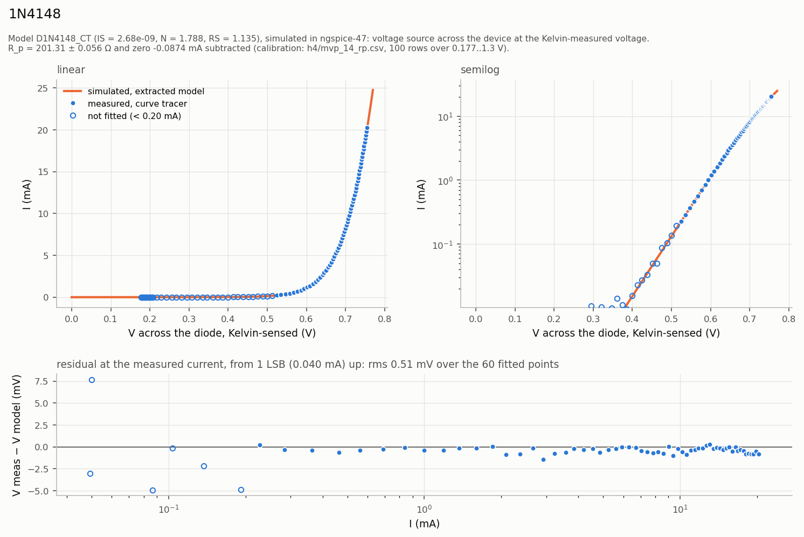
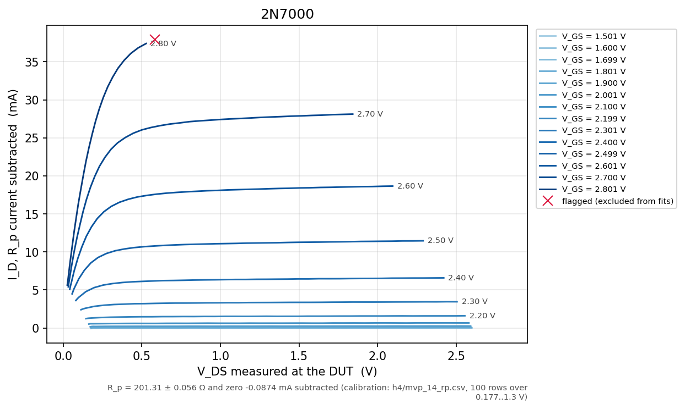
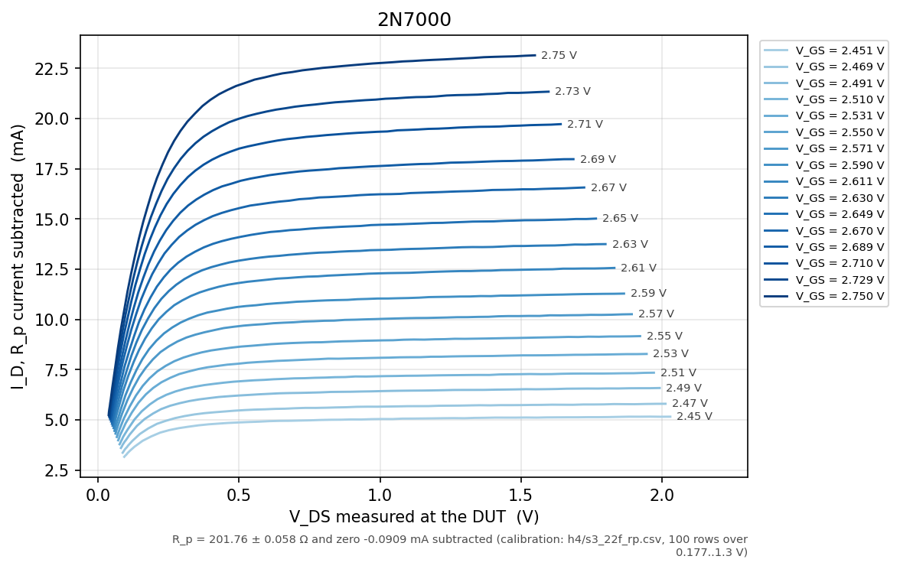

# Curve Tracer

A low-cost semiconductor curve tracer for small-signal MOSFETs and diodes. It
sweeps the voltage across a device, measures the current through it with
four-wire (Kelvin) sensing, and streams the result over USB. A Python host then
fits the device's parameters (threshold voltage, transconductance, channel-length
modulation; diode ideality, saturation current and series resistance) and writes
them out as a SPICE `.model` card. The aim is to close the loop
`device → measurement → model → simulation` on hardware I designed.

It is built as an assembled PCB carrying an STM32 Nucleo-F303RE, with firmware
in C and a Python host.

## Status, 2026-11-13

Every claim below is one of five things. **Measured** means on the bench,
from the board. **Analysis** means arithmetic on measured figures, or a
comparison with published ones. **Simulated only** means LTspice, ngspice
or the firmware simulator, with no bench result yet. **Done** covers work that needs no
measurement. **Not done** is what's left. Nothing in this README goes past
its row.

| Claim | Status | Evidence |
|---|---|---|
| Analog design: stability into capacitive loads, current limiter, sense-amp CMRR | Simulated only | LTspice sims 02–11, [below](#simulation-results) |
| Schematic and 2-layer PCB, DRC/ERC clean, topology checker | Done | `hardware/review/pass2/` |
| Five boards fabricated and fully assembled by JLCPCB | Done | `hardware/ORDER.md` |
| Firmware runs on the Nucleo; host link works | Measured | 2026-10-30 to 2026-11-13 captures (`host/h4/`) |
| Board powers up; loop quiet into 200 Ω ‖ 100 nF (L1), idle and 0.1–6 V | Measured | 2026-11-03 and 2026-11-08, [bench record](#bench-record) |
| 100 nF alone across a two-terminal device keeps the loop quiet, on a breadboard fixture | Measured, 2026-11-13: idle, 0.2–6 V, beside 0.1% resistors and through a diode sweep. Sim 16 predicted it. MOSFET families stay on L1 | [Session 3](#session-3-board-2-2026-11-13) |
| Loop stable with nothing connected (C1 empty) | **Measured: fails.** Oscillates at 0.8–1.15 MHz | [The open-load oscillation](#a-measured-finding-the-open-load-oscillation) |
| Root cause of the oscillation | Analysis and simulation | Sims 12–14 |
| C1 in the 2.2–4.7 pF range damps it | Simulated only (TI's op-amp model, open load and 200 Ω ‖ 100 nF) | Sims 14–14f; not fitted, since 0603 can't be hand-fitted here. Rev 2 specifies 4.7 pF |
| 470 Ω across the device keeps the loop quiet | **Measured: fails.** Oscillates at 781 kHz with nothing running. Sim 13 had predicted quiet | [Working around it](#working-around-it-until-rev-2) |
| L1 (200 Ω ‖ 100 nF) across the device keeps it quiet, and why | Measured; the mechanism is analysis and simulation (sim 15) | [Working around it](#working-around-it-until-rev-2) |
| Voltage accuracy against a DMM | Measured, 3 points: within the DMM's own ±0.8%. Blueprint §7's < 0.5% needs a better reference | [Accuracy](#accuracy-against-a-dmm) |
| Current against voltage, 0.1% resistors | **Measured**, 2026-11-13: current reads 0.1–0.8% high against the voltage, or up to 1.5% if the resistors sat behind the fixture's ~0.5 Ω (analysis; MVP card §F decides). Zero −0.09 to −0.14 mA. Absolute current ±1.6% (±2.3%) uncorrected, set by the voltage's DMM check | [Session 3](#session-3-board-2-2026-11-13) |
| The current channel with nothing drawing current | **Measured**: it reads a floor, 0.198 + 0.104 · V mA, not its zero; the difference amp's swing limit (analysis, TI's datasheet). The host leaves such rows out | [Session 3](#session-3-board-2-2026-11-13) |
| R_p subtraction, channel model, extraction, `.model` card, ngspice overlay | Done; run on bench data 2026-11-08 and 2026-11-13 | `host/`, 203 tests |
| Diode parameters from a real diode | **Measured**: 1N4148, n 1.789, I_S 2.68 nA, R_s 1.14 Ω. Systematic from the zero and the channel model: n 1.788–1.831, I_S 2.15–3.69 nA, R_s 1.01–1.14 Ω | [Headline figure](#headline-one-real-diode-measured-and-simulated) |
| Measured vs simulated overlay, real diode | **Measured**, against ngspice running the extracted card: 0.51 mV rms over 0.2–20 mA | [Headline figure](#headline-one-real-diode-measured-and-simulated) |
| Diode against published 1N4148 models | Analysis: between LTspice's and Nexperia's, 8–24 mV from each | [Session 2](#session-2-board-2-2026-11-08) |
| MOSFET `.model` card from a real part | **Fixture-dependent, under investigation.** Measured 2026-11-13 (2N7000, Level 1, 16 gate steps, saturation only), but on a fixture that put ~0.4 Ω in its source path (analysis), and 86 mV of gate from the same part on 11-08 is unexplained. Not a headline result | [The 2N7000 card](#the-2n7000-card-fixture-dependent-under-investigation) |
| MOSFET threshold | **Measured**, 2026-11-08: **V_GS(th) 2.147 V at 1 mA**, model-free; the measured threshold. The same part on 11-13 needed ~90 mV more gate, under investigation | [Session 2](#session-2-board-2-2026-11-08) |
| Waves on the scope with a MOSFET in place | Measured on the scope: 748 kHz in an 11-08 hold; none in an 11-13 hold; waves during both sweeps. Under 10 µA in the DC readings. Sustained or not: open | [Session 3](#session-3-board-2-2026-11-13) |
| Blueprint §6 closed loop: build a circuit with the extracted model, compare | Not done | |
| Short-circuit and thermal test (H4 Block 4) | Not done | No heatsink insulator at the bench |
| Current ranges 2 and 3 (fitted on the board) | Not done | Out of scope |

### Headline: one real diode, measured and simulated



*Measured, 2026-11-08, board 2: a 1N4148 swept to 20 mA, four-wire,
`device → measurement → model → simulation` closed on real data. The dots
are the measurement, with L1's current and the instrument's zero subtracted
(`host/h4/mvp_17_diode_rp.csv`). The line is ngspice-47 running the
`.model` card the host fitted from those dots
(`host/h4/mvp_17_diode.lib`: n 1.789 ± 0.003, I_S 2.68 ± 0.06 nA,
R_s 1.135 ± 0.016 Ω, statistical). **The larger uncertainty is
systematic.** The instrument's current zero measured −0.087 mA on the
calibration and −0.099 mA on the diode's own off rows. Refitted at each,
the values span n 1.788–1.831, I_S 2.66–3.69 nA, R_s 1.01–1.14 Ω. The
0.1% resistor holds of 2026-11-13 add two smaller terms. Current reads
0.1–0.8% high against voltage, and the voltage channel may read 10 mV low.
That would take I_S to 2.15 nA, so in all **n 1.788–1.831, I_S
2.15–3.69 nA, R_s 1.01–1.14 Ω**. n and I_S trade off against each other,
so the curve itself moves at most 3 mV, or 10 mV with the voltage
offset. Residual 0.51 mV rms over the 60 points above 0.2 mA. Of that, −0.38 mV is a constant: ngspice's default 27 °C against
the fit's 300 K. Hollow points sit below 5 current LSB and are not fitted.
The curve lies between the two published 1N4148 models compared, 8–24 mV
above LTspice's and 10–14 mV below Nexperia's (diode temperature not
measured; ~2 mV/°C).*

*Why this capture stays the headline after a second one (2026-11-13).*
On 11-08 L1 lifted every reading clear of the current channel's floor, and
its own calibration line gave the zero at the same voltages. The 11-13
capture, on 100 nF alone, has 39 of 100 rows on the floor, so its zero has
to be borrowed from holds at other voltages. Its n also moves 2.5× more
with the low-current cut. That rule was set before comparing values
([session 3](#session-3-board-2-2026-11-13)). The 11-13 diode reads 23–44 mV
higher at equal current, and it is the same diode. A fixture resistance
of ~0.5 Ω between the Kelvin points and the part accounts for its higher
R_s, and for 0.6 mV of the 22 mV at 1 mA. The rest is unexplained
(analysis; MVP card §F tests it).


*KiCad render of the routed board (Pass 2, 2026-10-06), not a photograph. The
Nucleo plugs into the two sockets on the right. Board size 135 × 92 mm, two
layers.*

## What it can measure

The design envelope. Nothing in it is measured yet unless the row says so.

| | |
|---|---|
| **Devices** | Two-terminal devices (diodes, LEDs, resistors) and **N-channel enhancement MOSFETs**. **No BJTs**: the step source is a voltage through 1 kΩ, not a base current. **No P-channel or depletion parts**: the gate source is 0 to +10 V |
| **Polarity** | **One quadrant.** Drain/anode at 0 to +10 V and current into the device only. No reverse bias |
| **Voltage** | 0–10 V by design; 9.06–9.73 V is the ceiling at 50 mA (analysis: the PTC fuse's drop). **Floor measured: 0.18 V** at the node (DAC code 0, 2026-11-08), well below the 0.66 V the DAC's guaranteed 0.2 V minimum implies. Above ~6.6 V the Nucleo's LED loads the DAC: estimated, not measured |
| **Current** | 0–50 mA on range 1, 40.3 µA per ADC count, averaged 64× per point. Hardware limiter ~75 mA (simulated); firmware limit set per device. **Floor measured:** with nothing lifting it, the channel reads no lower than 0.198 + 0.104 · V mA, so on 100 nF alone a device registers only above ~0.4–0.5 mA at 0.6 V; on L1, from 0.2 mA |
| **Mode** | **DC only.** No pulsed mode, so the device heats at its own dissipation |
| **Accuracy** | Voltage: within a 3½-digit DMM's ±0.8% (2026-11-08). Current against voltage: 0.1–0.8% high, from 0.1% resistors (2026-11-13), or up to 1.5% if they sat behind the fixture's ~0.5 Ω. So absolute current is ±1.6% (±2.3%) uncorrected. Zero −0.09 to −0.14 mA, subtracted. [DMM](#accuracy-against-a-dmm), [resistors](#session-3-board-2-2026-11-13) |
| **Until rev 2** | The loop needs ≥ 100 nF across the device. **Two-terminal parts:** 100 nF alone, on a breadboard fixture (measured quiet, 2026-11-13), with nothing to subtract. **MOSFET families, and a diode's bottom decade:** L1, 200 Ω ‖ 100 nF. The host subtracts L1's current from a calibration sweep (~1.5 µA at 0.75 V on 2026-11-08), and L1 lifts the channel off its floor. A plain 470 Ω was not enough (measured) |

**What it's for.** It replaces the undergraduate I-V lab done by hand with
a bench supply and two meters, one point at a time, for small diodes, LEDs
and small N-MOSFETs. It records the curve with four-wire sensing and fits a
SPICE model from it. **What it isn't:** a general-purpose commercial curve
tracer or source-measure unit. Those cover high voltage and current, both
polarities, pulsed measurement, BJTs and picoamp leakage. This covers none of
them.

## Limitations

What the results above do not cover, as of 2026-11-13:

- **Waves on the scope with a MOSFET in place are unexplained.** On 11-08
  a hold's counter locked at 748.5 kHz; on 11-13 a hold showed nothing
  periodic, but waves showed during both family sweeps. They move the DC
  readings by under 10 µA. Whether they are sustained, and which loop they
  come from, is open.
- **The gate voltage is commanded, not read back.** The read-back step
  (H4 P1b) was skipped, so every V_GS, including the 2N7000's threshold,
  carries the gate DAC's unmeasured gain error.
- **The MOSFET card is narrow and fixture-dependent.** It is Level 1,
  fitted over V_GS 2.45–2.75 V, and holds in saturation only: below
  V_DS ≈ 0.4 V it reads up to 4.2 mA low, because the part is in moderate
  inversion. It was taken on a fixture that degenerated the source by
  ~0.4 Ω (analysis). It stays under investigation until MVP card §F reruns
  it with the Kelvin pair and the force wires at the part.
- **The same two parts read differently from one session to the next.** On
  11-13 the 1N4148 read 23–44 mV higher, and the 2N7000 needed ~90 mV more
  gate, than on 11-08. *Analysis:* ~0.4–0.6 Ω of breadboard links
  between the Kelvin points and the parts explains the resistive part of
  both, and of L1's fitted R. It can't explain a constant +21 mV on the
  diode or +86 mV of gate. Self-heating during the sweeps can't either: it
  is under 0.3 K per sweep, and the 2N7000's is the wrong sign. That leaves
  the parts' surroundings, which weren't measured. The constants are
  unexplained.
- **Blueprint §6's closed loop is not done.** The diode's model is checked
  against its own measurement. No circuit has been built around it and
  compared with the bench.
- **Absolute accuracy rests on a 3½-digit DMM.** The 0.1% resistors fix
  current against voltage to 0.1–0.8% (1.5% if the fixture's resistance
  sat in series with them), but voltage itself is bounded only at the DMM's
  ±0.8%. Part of the spread is one open question: a −10 mV voltage offset,
  or a curved common-mode term. Section F's holds decide both.
- **The bench supply can be off without the instrument knowing.** Nothing
  reads +15 V. On 11-13 three runs were taken with it off and produced
  plausible numbers; the card now checks the supply's display after every
  part swap.

## A measured finding: the open-load oscillation

**Measured, 2026-11-03, board 2, C1 empty.** Holding 6 V into
200 Ω ‖ 100 nF, the loop was quiet. With nothing connected it oscillated
intermittently at **0.79–1.15 MHz**, from over 0.2 V to over 2 V
peak-to-peak (the scope clipped). In the run with the largest
oscillation, the current read 2.2 mA high. (The other two runs' 0.83 mA,
first read as error too, is the channel's floor with nothing drawing
current, measured on 2026-11-13 with the loop quiet.) Full data is in
[Block 1](#block-1-measurements-first-power-up-board-2) below and in
[`docs/characterization.md`](docs/characterization.md).

**Root cause (analysis, checked in LTspice sims 12–14).** With no load, the
pass transistor (Q1) carries only ~0.2 mA. Its emitter resistance is then
~130 Ω, and it drives the ~1 nF of the protection diode D3 through ~41 Ω.
That puts a pole near 0.8 MHz inside the loop. Under the 200 Ω load, Q1 runs
at 26 mA and the pole moves far out. So the problem depends on the load,
which is why it shows up well below the ~3 MHz the design had estimated for
the op-amp's input-capacitance pole. The generic op-amp model reproduces
the oscillation only with 20–30 pF of input capacitance added. TI's own
OPA2197 model needs none: at open load it rings at 0.91 MHz, each
half-cycle 0.83× the last, close to sustained.

**The fix (simulation, sims 14–14f, TI's model).** The board has an empty
footprint for C1, a capacitor across the feedback resistor. The predicted
value is **3.4–3.9 pF**. At 6 V open load, 3.3 pF cuts the ring to 0.40×
per half-cycle, and 4.7 pF removes it, with no sign of over-compensation.
The generic model's figure, 8.6–12.9 pF, would over-compensate. Because the
bench was less damped than TI's model, rev 2 specifies **4.7 pF**
(`hardware/DECISIONS.md` R2-4). That rests on one vendor model. C1 is a
0603 part, which I can't fit reliably by hand, so it isn't fitted on rev 1.
Rev 2 has the assembler fit it.

### Working around it until rev 2

**Measured, 2026-11-08.** Sim 13 predicted that 470 Ω clamped across the
device would keep the bare loop quiet. On the bench it didn't: with nothing
running, 470 Ω oscillated at **781 kHz**, over 205 mV peak-to-peak. The
loop is never fully off. The sweep DAC can't reach 0 V, so at idle it holds
the node at 0.18 V, and that is where 470 Ω failed. L1, the
200 Ω ‖ 100 nF load from Block 1, was quiet at idle and at every level
tried, 0.1–6 V. So every device now shares J6 with L1, and the host
subtracts L1's current, calibrated by a sweep of L1 alone.

**Why it is the 100 nF (analysis, checked in sim 15 with TI's model).**
The load puts a lag of 20–30° into the loop. Without the 100 nF that lag
sits at 1.5–5 MHz, around crossover, on top of the op-amp's own excess
phase. With it, the same lag moves two decades down, to 20–60 kHz, where
the loop has phase to spare. L1 also biases Q1 harder (0.9 against
0.4 mA). In sim 15 that only shrinks a ring the 100 nF removes outright.
Sim 13's error was its model. The generic op-amp with 20–30 pF added had
been fitted to reproduce one bench point, the open-load oscillation, and
it was optimistic everywhere else. TI's model is optimistic too, though
less so: it rings and decays where the bench sustained. Phase 0 had the
same lesson about the BD139 model (design decision 2 below).

**100 nF alone, on a breadboard fixture (measured, 2026-11-13).** Sim 16
said the capacitor, not the resistor, was doing the work, and the bench
agreed. With only 100 nF across D–S, plugged into a breadboard with the
Kelvin pair at the device's own columns, the loop showed no periodic wave
at idle, at 0.2, 1 and 6 V, beside 0.1% resistors, or through a diode
sweep. Two-terminal parts no longer need L1, so there is no current to
subtract. MOSFET families still do: with no resistor, the node can't
discharge between gate steps below ~0.6 V. One practical lesson: the
breadboard's centre channel splits each column. The first MOSFET attempt
had its legs across it, its gate was undriven, and the family came out
flat.

## Design decisions

Each of these is backed by a simulation, a calculation or a datasheet figure.
The full record, part by part, is [`hardware/DECISIONS.md`](hardware/DECISIONS.md);
the reasoning is in [`curve_tracer_blueprint.md`](curve_tracer_blueprint.md).

1. **Isolate the capacitive load; don't compensate it.** The obvious fix, a
   capacitor across the feedback resistor, made the loop *worse* at every value
   from 1 to 100 pF. Instead, a 22 Ω `R_iso` sits outside the loop, and Kelvin
   sensing makes its 1.1 V drop at 50 mA harmless (sims 02, 03).
2. **Model fidelity decided the answer.** With a generic 2N2222 model the
   loop looked unconditionally stable. ST's published BD139 model (f_T ≈ 54 MHz,
   C_jc 36 pF) oscillated immediately. A third-party BD139 model found online
   had placeholder junction capacitances (`CJE = CJC = 1e-11`) and would have
   hidden the problem. A separate false result, 9% overshoot, turned out to be
   a solver timestep artefact. Capping the timestep removed it
   (blueprint §12).
3. **Base resistor 330 Ω, not 680 Ω.** Both are stable in simulation, but
   680 Ω leaves ~44° of implied phase margin, against ~59° for 330 Ω. The
   op-amp's own input capacitance adds a pole the simulation does not contain
   (estimated 5–9 pF), and from 44° that loss is not recoverable (sim 08).
4. **A base-emitter clamp diode.** On a falling edge the op-amp slams to its
   rail while the load holds the emitter up, and V_BE reaches −9 V against the
   BD139's 5 V rating. A 1N4148 holds it to −0.74 V (sims 08, 09).
5. **A hardware current limiter**, Q2 across a 10 Ω `R_sense`, independent of
   the firmware limit. 15 Ω was rejected because its trip point (~49–50 mA)
   falls inside the sweep range (sims 10, 11).
6. **Buffer the difference amplifier's inputs.** Unbuffered, the resistor
   bridge alone draws 475.6 µA through the shunt with nothing connected. That
   is 0.95% of full scale on range 1 and makes range 3 unusable. The design
   went from two to three dual op-amps (sims 06, 07).
7. **0.1% resistors in the difference amp**, because common-mode rejection
   comes from resistor matching alone and cannot be trimmed afterwards (sims 04,
   05).
8. **One board revision, designed for it.** There is a test point on every
   node, footprints for alternate values, headers instead of soldered
   connections, and a footprint for the compensation capacitor, left empty.
   JLCPCB assembled every part on all five boards.
9. **The host slices on *measured* voltage, never the commanded voltage.** At
   one commanded voltage, curves at different currents reach different real
   voltages because of `R_iso`'s drop. Grouping by the command gives a
   convincing but wrong threshold voltage. The diode fit solves n, I_S and R_s
   jointly; a windowed semilog fit was 13% wrong on n at R² = 0.9965
   ([`host/README.md`](host/README.md)).

Two decisions changed when they met reality. They are recorded as rev-2 items,
not hidden:

- **The F303RE has no DAC2.** The board routed the sweep to a pin with no DAC.
  This was found at the first real firmware build. The fix is a jumper on the
  Nucleo from PA5 (DAC1_OUT2) to PA6. PA5 also drives the Nucleo's LED, which
  loads the DAC and may cut sweeps above about 6.6 V (estimated, not yet
  measured; `DECISIONS.md` R2-3).
- **The empty compensation-capacitor footprint assumed hand-fitting**, a
  0603 part, which I could not do reliably. Rev 2 has JLCPCB fit it, at
  4.7 pF (`DECISIONS.md` R2-2, R2-4).

## Simulation results

**All of these are simulated.** LTspice files are in [`sim/`](sim/), with
per-file detail in [`sim/README.md`](sim/README.md). The sweep-source sims
ran at R_f = 23.3 kΩ; the board has 23.2 kΩ, a 0.4% difference below the
precision of every figure here.

| Question | Result (simulated) | Simulation |
|---|---|---|
| Capacitive load the sweep source tolerates | Without `R_iso`: stable to ~1 nF, oscillating by 2.2 nF. With 22 Ω: clean from 100 pF to 100 nF | LTspice, `sim/03_sweep_source_load_sweep.asc` |
| Small-signal step, 100 nF ‖ 200 Ω, R_B = 330 Ω | 10.34% overshoot, 0.50 µs to 1%, ζ ≈ 0.59 (~59° implied phase margin) | LTspice, `sim/08_sweep_source_rb_sweep.asc` |
| Reverse V_BE on a falling edge, 100 nF load | −7.72 V → −0.73 V (200 Ω load); −8.98 V → −0.74 V (open), with the clamp | LTspice, `sim/08…`, `sim/09_sweep_source_clamped.asc` |
| Current-limiter trip; hard short | 75.2 mA through R_sense; 107.0 mA load; BD139 at 891 mW | LTspice, `sim/11_limit_sizing.asc` |
| Overshoot on recovery from a short, 100 pF load | 14.8 V peak (+48%); back within 1% in 1.9 µs | LTspice, `sim/10_current_limit.asc` |
| Difference-amp CMRR, worst-case 0.1% corner | 74.42 dB | LTspice, `sim/04_diffamp_cmrr.cir` |
| CMRR, 500-run Monte Carlo at 0.1% | median 88.26 dB, p5 79.43 dB, min 76.20 dB | LTspice, `sim/05_diffamp_mc.cir` |
| Phantom current, unbuffered diff amp, no DUT | 475.6 µA at 1 Ω shunt | LTspice, `sim/06_diffamp_loading.cir` |


*Simulated: CMRR over 500 Monte Carlo runs with 0.1% resistors
(`sim/05_diffamp_mc.cir`). LTspice draws uniform, independent tolerances, so
this spread is conservative.*

Sims 02–11 didn't model D3's ~1 nF, the PTC or the Kelvin divider; sim 12
added them. That is the gap the board fell into at open load: see
[the finding](#a-measured-finding-the-open-load-oscillation).

### Host software, closed loop on a simulated device

`ct_sim` is the real firmware core (sweep engine, CSV writer, command parser,
current limit), compiled for the desktop with a modelled device behind it. The
host's tests feed it known parameters, run a sweep, extract the parameters, and
require the same values back. **Simulated, `ct_sim`:**

| Fed in | Recovered |
|---|---|
| V_th = 2.15 V | 2.1502 V (0.2 mV) |
| k = 0.055 A/V² | 0.05506 (0.1%) |
| λ = 0.012 /V | 0.01192 (0.7%) |
| diode n = 1.75 | 1.7605 (0.6%) |
| diode I_S = 2.5 nA | 2.73 nA (9%; quantisation, explained in [`host/README.md`](host/README.md)) |
| diode R_s = 0.6 Ω | 0.5914 Ω (1.4%) |

With a 470 Ω resistor beside the device, its current subtracted, and the
extracted card run back through ngspice, the simulated diode comes back as
n = 1.751, I_S = 2.52 nA and R_s = 0.601 Ω, with a 0.63 mV rms residual
([`host/README.md`](host/README.md#from-a-capture-to-the-overlay)). 203
host tests and the firmware unit suites pass. That validates the software
path only. It says nothing about the analog hardware.

## Block diagram

```
   Nucleo-F303RE                     Board
  ┌──────────────┐
  │ DAC1_OUT2 PA5├─shunt─► PA6 ─► [×3.32] ─► [OPA2197 + BD139 follower] ─► R_sense ─┬─► R_iso 22Ω ─► PTC ─► shunt ─► DUT drain
  │              │                                ▲      │                         │                        │            │
  │              │                                │   [Q2 current limiter]        │                   [buffered     [Kelvin pair
  │              │                                └─────────── feedback ──────────┘                   diff amp ×20]  ÷4 + buffer]
  │ ADC1  PA0   ◄├──────────────────────────────────────────────────────────────────────────────────────────┘            │
  │ ADC2  PC0   ◄├───────────────────────────────────────────────────────────────────────────────────────────────────────┘
  │ DAC1_OUT1 PA4├─────► [×3.32] ─► [buffer] ─► 1 kΩ ─► DUT gate  (12 V Zener clamp)
  │ USART2 ◄─────┼─► ST-LINK VCP ─► USB ─► Python host
  └──────────────┘                                                     DUT source ─► GND        (SMAJ12A TVS on the drain)
```

Per point: set the gate DAC, set the drain DAC, wait to settle, oversample both
ADCs 64×, send a CSV row. The host recomputes current and voltage from the raw
accumulators and checks them against the firmware's own numbers.

## PCB


*KiCad render, top view (`hardware/review/pass2/`). The analog section is on the
left, with the Nucleo sockets J7/J8 on the right. Q1's heatsink keep-out is
marked at the top left.*

- The analog-critical nets were routed by hand: the feedback node, the
  inverting input, the base drive, the shunt and Kelvin pairs. The rest was
  autorouted (Freerouting) with those nets locked
  ([`hardware/README.md`](hardware/README.md), *Routing policy*).
- DRC and ERC are clean with schematic parity
  (`hardware/review/pass2/metrics.txt`). `check_topology.py` asserts the
  circuit's topology from the netlist (59 checks) and catches all 14 faults
  its self-test plants, which ERC passes.
- Every net that crosses the ground split, and its distance to the star
  tie: [`p2_split_crossings.png`](hardware/review/pass2/p2_split_crossings.png).

## A bench finding: the ST-LINK serial link on macOS

The first time the host talked to the Nucleo (2026-10-30), every command timed
out. A single host write of **16 bytes or more** stopped the ST-LINK/V2-1's
virtual COM port passing data from host to target until the USB cable was
replugged. This was on firmware V2J33M25, under macOS. Writes of 8 bytes,
5 ms apart, got through. The first write after the ST-LINK enumerates was also
lost.

To rule out the firmware, I read the MCU state over SWD while the link was
wedged. The main loop was idle, USART2 was configured, and no bytes were
reaching the RX pin (PA3). The fault is upstream of the MCU, in the ST-LINK's
USB-to-UART bridge. The fix is host-side: the transport writes in 8-byte
chunks 5 ms apart and opens with a blank line, which the firmware's parser
ignores. A regression test checks that no single write reaches 16 bytes. After
the fix, two hold runs back to back worked after a replug (commit `2debc57`).
An ST-LINK firmware upgrade might also fix it. That is untested.

## Bench record

### Block 1 measurements: first power-up, board 2

**Measured, 2026-11-03**, from [`hardware/MVP_CARD.md`](hardware/MVP_CARD.md)
(raw data in `host/h4/mvp_*.csv`; full log in
[`docs/characterization.md`](docs/characterization.md)). A pass here shows
no sustained oscillation under a DC hold. It does not measure phase margin
or ringing (H4 step 5, not run). C1, the compensation capacitor, is empty.

| Measurement | Pass band | Result |
|---|---|---|
| Supply current at power-up | 3–25 mA | 3 mA, supply in CV (rails not checked) |
| Scope baseline at TP3, idle (B) | < 10 mV p-p | 12.0 mV, board powered |
| Hold 6 V into 95.2 nF ‖ 202 Ω (measured): p-p at TP3 | ≤ B + 5 mV | 12–30 mV; 26.8 mV, and 26.0 mV with the probe ground moved. Broadband, no periodic component |
| … measured V, I | 4.8–5.5 V, 23–29 mA | 5.193 V, 25.74 mA (5.193 V / 202 Ω = 25.71 mA) |
| Hold 6 V, open load: p-p at TP3 | ≤ B + 5 mV | **Oscillates**: > 0.2 V to > 2 V p-p (clipped), varying run to run |
| … measured V, I | 5.7–6.2 V, ≤ 0.5 mA | 6.006–6.192 V; 0.830 and 0.832 mA in two runs, 2.998 mA in the run with the largest oscillation. *Corrected 2026-11-13:* the 0.83 mA is the channel's floor with nothing drawing current (0.82 mA at 6 V with the loop quiet), so the 0.5 mA band could not pass. Only the 3.0 mA was oscillation error |
| Oscillation frequency | — | ~0.79 MHz (read while clipped) and 1.149 MHz |
| **Block 1 verdict** | | **Fail**: no sustained oscillation with a 200 Ω ‖ 100 nF load; intermittent ~0.8–1.15 MHz oscillation at open load, C1 empty |

The 26 mV under load is over the card's limit, but it is broadband noise,
not oscillation. The limit allowed less than 2 DAC steps at TP3.

### Session 2, board 2, 2026-11-08

**Measured**, from [`hardware/MVP_CARD.md`](hardware/MVP_CARD.md) §D
(raw data in `host/h4/mvp_13c*` to `mvp_18*`; full log, with the analysis
labelled, in [`docs/characterization.md`](docs/characterization.md)). C1
empty, L1 across D–S throughout.

| Step | Result |
|---|---|
| 470 Ω across D–S, idle | **Oscillates**, 781 kHz, > 205 mV p-p. Session switched to L1 |
| L1, idle / 0.1 V / 0.3 V | Quiet: 22.4 / 20.0 / 20.4 mV p-p, noise only |
| Sweep floor | 0.18–0.19 V at the device (DAC code 0) |
| L1 calibration sweep | R = 201.31 ± 0.06 Ω, zero −0.087 mA, max residual 0.016 mA |
| Accuracy, 3 points | See below |
| 1N4148 ‖ L1 | n 1.789, I_S 2.68 nA, R_s 1.14 Ω; zero systematic n 1.788–1.831, I_S 2.66–3.69 nA, R_s 1.01–1.14 Ω. The [headline figure](#headline-one-real-diode-measured-and-simulated) |
| 2N7000 ‖ L1, 14 gate steps 1.5–2.8 V | V_GS(th) 2.147 V; family below. Stopped at the 40 mA limit on 2.8 V, so 2.9 and 3.0 V didn't run |

**The instrument's current zero.** With L1's current removed, an off
device read −0.09 mA in every capture: the calibration, the diode below
0.25 V, and the MOSFET's off steps. The host used to subtract L1's
`V / R` but leave that zero in. At the diode fit's 0.2 mA floor the zero is
43% of the current, and leaving it in read n as 1.651 and I_S as 0.83 nA.
The host now subtracts the calibration's whole line, zero included. That
fits 2.7× tighter, with 2.4× less residual.

#### Accuracy against a DMM

L1 held at three levels, DMM (BK 2704A, 3½ digits) across J6. The current
reference is V_DMM / R_DMM, with R_DMM = 200 Ω.

| Hold | Instrument V | DMM V | ΔV | Instrument I | V_DMM / 200 Ω | ΔI |
|---|---|---|---|---|---|---|
| 2 V | 1.7337 V | 1.74 V | −6.3 mV | 8.526 mA | 8.700 mA | −0.174 mA |
| 4 V | 3.4631 V | 3.47 V | −6.9 mV | 17.149 mA | 17.350 mA | −0.202 mA |
| 6 V | 5.1930 V | 5.20 V | −7.0 mV | 25.779 mA | 26.000 mA | −0.221 mA |

- **Voltage:** gain −0.02%, offset −6 mV against the DMM. The DMM is good
  to ±0.8% + 10 mV, so the error is bounded at that, not measured below it.
- **Current:** gain −0.28%, offset −0.15 mA against V_DMM / R_DMM. That
  reference is good only to about ±3%, because R_DMM is read on the 2 kΩ
  range (±6 Ω), and all three errors sit inside it. The offset agrees
  with the instrument's own zero, −0.087 mA, to about one DMM count.
- **ADC reference:** 3.30 V at TP8, ±1.1% on the DMM.
- Blueprint §7 asks for <0.5% voltage and <1% current error. Showing that
  needs a 5½-digit meter and 0.1% resistors; this session can't.

#### The 2N7000



*Measured, 2026-11-08, board 2: a 2N7000 with L1's current and the
instrument's zero subtracted (`host/h4/mvp_18_mosfet_rp.csv`). Fourteen
gate steps, commanded, not measured. The sweep stopped where the total
current passed 40 mA (×), so 2.9 and 3.0 V were never applied.*

| | Value | Note |
|---|---|---|
| V_GS(th) at I_D = 1 mA, V_DS = V_GS | **2.147 V** | Model-free, the datasheet's definition. onsemi: 0.8 / 2.1 / 3.0 V min/typ/max |
| g_m at V_DS = 1.5 V | 13.6 mS at 1.5 mA; 39.9 mS at 6.4 mA; 82.7 mS at 18.4 mA | |
| λ, apparent | 0.027–0.029 /V (V_GS 2.4–2.7 V) | Includes self-heating: the sweep is DC |

**No `.model` card on 11-08** (session 3 wrote one, over a narrower
window: [below](#the-2n7000-card-fixture-dependent-under-investigation)). A SPICE Level-1 card assumes the square law, √I_D
linear in V_GS. Over the 0.2–28 mA that range 1 resolves, this part is in
moderate inversion: g_m / I_D falls from 11.8 to 4.5 /V. So the fitted
V_th moves 0.14 V and KP 1.7× with the choice of gate steps. A card from
any one window would misfit the rest by tens of percent. Fitting this part
needs gate voltages ≥ 3 V, where its current passes range 1's 50 mA, or a
model with a moderate-inversion region.

**A caveat from the scope (11-08).** During the family sweep the scope at TP3
showed periodic waves. In a 20 s hold at V_GS 2.4 V the counter locked at
**748.5 kHz**, at 28 mV p-p against a 20 mV noise floor. It doesn't reach
the DC readings: the hold's scatter is within ~5 µA of the L1-only holds,
and every curve above is as smooth as an L1-only sweep. The reason is that
L1's 100 nF holds the device node to ~1 mV of it, and the sense chain
stays linear and averages it out (analysis). Whether it is a small
sustained oscillation or a lightly damped mode driven by noise is **not
established**. Which loop it belongs to is open too: the MOSFET's gate
path is the new element.

### Session 3, board 2, 2026-11-13

**Measured**, from [`hardware/MVP_CARD.md`](hardware/MVP_CARD.md) §E (raw
data in `host/h4/s3_*`; full log, with the analysis labelled, in
[`docs/characterization.md`](docs/characterization.md)). C1 empty. The
device sits on a breadboard, wired to J6, with the Kelvin pair at its own
columns.

| Step | Result |
|---|---|
| 100 nF alone across D–S: idle, 0.2, 1, 6 V | **Quiet**: 4.8–6.8 mV idle, 23–25 mV in holds, broadband; the counter never locked |
| Current with nothing drawing it | 0.230, 0.298, 0.824 mA at 0.24, 1.0, 6.0 V: the channel's floor (below) |
| 0.1% 100 Ω at 2 V; 1 kΩ at 2 V and 6 V (100 nF beside each) | Quiet. g 1.0080, zero −0.131 mA, common-mode −0.0225 mA/V (below) |
| L1 calibration | R 201.76 ± 0.06 Ω, zero −0.091 mA (11-08: 201.31 Ω, −0.087 mA) |
| 1N4148 ‖ 100 nF | Quiet. n 1.94–1.95 through the channel model, 39 rows on the floor; not the headline |
| 2N7000 ‖ L1, 16 gate steps 2.45–2.75 V | No trip, 16 of 16 steps fitted: [a model card](#the-2n7000-card-fixture-dependent-under-investigation) |
| Runs with the bench supply off | Three, overwritten. Their numbers looked plausible |

**The current channel's floor.** The card expected a channel with nothing
drawing current to read 0 counts. It reads **0.198 + 0.104 · V mA** instead
(four holds, within 5 µA), and it read the same at open load on 11-03.
*Analysis:* the instrument's zero is negative, so at zero current the
difference amp's output would have to go below ground. Its op-amp, on a
single supply, stops ~4 mV above it. That is TI's 5 mV typical, rising
~44 Ω × the 48 µA per volt the stuck output sinks through its feedback
resistor. A reading on that floor bounds the current; it doesn't measure
it. The host now leaves such rows out. Before that, they had been taken for
the zero: a diode fit read n 1.495, which is withdrawn.

**Current against voltage (0.1% resistors).** Three holds solve
I_read = g · I + b + c · V exactly: **g = 1.0080 ± 0.0007**,
**b = −0.131 ± 0.002 mA**, **c = −0.0225 ± 0.0010 mA/V**. That c is 93 dB
of CMRR, against sim 05's 88 dB median. L1's line puts the zero 1 LSB
higher. A −10 mV voltage offset reconciles the two (g 1.0014; on 11-08 the
DMM read the voltage 6–7 mV low), and so would a curved common-mode term.
Two more holds would tell them apart. So **current reads 0.1–0.8% high
against voltage**, which passes the card's ±1.5%. Voltage is bounded only
by the DMM's ±0.8%, so absolute current is ±1.6% uncorrected, against 11-08's
±3%. One caveat (analysis): if the resistors sat behind the fixture's
~0.5 Ω links, described below, g is 1.013–1.015, still inside the band,
and absolute current is ±2.3%. `ct_host channel` fits this, and `--zero` applies it.

#### The 2N7000 card: fixture-dependent, under investigation

**Not a headline result.** 11-08's V_GS(th) 2.147 V at 1 mA stays the
measured threshold. This card was fitted on a fixture whose links put
~0.4 Ω in the source path, and the same part on 11-08 needed 86 mV less
gate for the same current, for reasons not yet known. Both are explained
below. MVP card §F reruns it with the fixture fixed, twice back to back,
to test self-heating as well.



*Measured, 2026-11-13, board 2: a 2N7000 beside L1, L1's current and the
instrument's zero subtracted (`host/h4/s3_25_mosfet.csv`). Sixteen gate
steps, 20 mV apart, commanded, not measured. The curves start at
3–5 mA, not zero: at its lowest code the sweep DAC still drives ~0.18 V
through the 31 Ω series string, and a part that is already on takes that
current at 0.04–0.09 V.*

```
* valid for  : V_GS 2.451..2.750 V, I_D 5.07..22.9 mA (16 points fitted, at V_DS = 1.100 V)
.model 2N7000_S3 NMOS (
+   LEVEL = 1
+   VTO   = 2.19338
+   KP    = 0.139949
+   LAMBDA = 0.0276693
+ )
```

| | Value |
|---|---|
| VTO | 2.193 V ± 7.4 mV (half the spread over 30 fit-window choices; fit error ± 4.8 mV) |
| KP·W/L | 0.140 ± 0.003 A/V² |
| λ | 0.0277 /V; 0.026–0.029 per step. Apparent: includes self-heating |
| √I_D linear in V_GS at V_DS 1.1 V | 16 of 16 steps, R² 0.998 |

The whole card, with its caveats, is `host/h4/s3_25_mosfet.lib`. **It fits
saturation only.** Run back through ngspice over the capture
([overlay](media/overlay_2n7000_s3.png)), it matches the family to
**0.24 mA rms for V_DS ≥ 0.5 V** (worst 0.61 mA). Below ~0.4 V it reads up
to 4.2 mA low: the part is in moderate inversion, and its knee is sharper
than Level 1's. 11-08 wrote no card because 14 steps 100 mV apart spanned
2.0–2.7 V, and no single square law fits that. Sixteen steps 20 mV apart
over 2.45–2.75 V do fit one. **Caveats** (in the card's header):

- V_GS is commanded; the gate DAC's error is in VTO.
- KP is 0.1–0.8% high from the current gain above.
- During the sweep the scope showed steady repeating waves. A 20 s hold
  inside the window (V_GS 2.6 V) showed nothing periodic, no more scatter
  than a resistor hold, and a current matching the family to 0.5%. Each
  curve is as smooth as on 11-08 (≤ 9 µA rms). So the waves move the data
  by under 10 µA; whether they were sustained or step transients is not
  established.

**Against 11-08, the same part.** 11-08's three top steps alone gave
VTO 2.150 V and KP 0.176 A/V² (one degree of freedom, no card). Compared at
equal current instead (*analysis*), tonight's part needs 88–96 mV more
gate, rising with current. That fits **86 mV + 0.42 Ω × I_D** to 0.5 mV
rms. Source degeneration alone doesn't fit: 32 mV rms.

- **The 0.42 Ω** is the fixture. On 11-13 the Kelvin jumpers sat in the
  breadboard's upper half and the parts in the lower half, joined across
  the centre channel. It also accounts for KP, which is −4.7% like for like.
  0.140 against 11-08's 0.176 A/V² is mostly 11-08's narrower window. L1's fitted R rose 0.45 Ω
  between the sessions, and the diode's series term 0.6 Ω.
- **The 86 mV** isn't a resistance, and neither is the diode's constant
  +21 mV. They would need 11-08's parts ~12 K (diode) and ≥ 25 K (2N7000)
  warmer, at the datasheets' −1.8 mV/K and −3.5 mV/K. **Self-heating
  during the sweeps can't supply that** (analysis). At θ_JA 357 °C/W and
  the thermal time constant the 11-13 hold shows (~100 s), a sweep warms
  the part by under 0.3 K, and under 5 K at the most pessimistic τ. 11-13's
  sweep also dissipated 3.4× the energy of 11-08's, so the 2N7000's sign is
  wrong. What remains is the parts' surroundings: J6 beside L1 and Q1 on
  11-08. That wasn't measured.

The full analysis is in [`docs/characterization.md`](docs/characterization.md).

### What's still open

Beyond the [limitations](#limitations):

- **C1** (rev 2, 4.7 pF), the fix for the bare loop, rests on TI's model,
  which has been optimistic twice (blueprint §11).
- **Rails, VHF check, step response, short circuit and thermal** (H4
  steps 2b, 4, 5; Blocks 3–4): not run.
- **Accuracy to blueprint §7's targets** needs a better voltage reference
  than a 3½-digit DMM. The 0.1% resistors have settled current against
  voltage.

## Repository

`hardware/`: KiCad project, decisions record, bring-up cards, order files ·
`firmware/`: STM32 firmware, host-side simulator `ct_sim`, unit tests ·
`host/`: Python capture, extraction, model cards and the ngspice overlay · `sim/`: LTspice and
Monte Carlo · `docs/`: characterization plans · `curve_tracer_blueprint.md`:
the design document.

## Cost

From `hardware/ORDER.md`, at the 2026-10-11 prices:

| | Total | Per board (÷ 5) |
|---|---|---|
| JLCPCB: PCB, assembly and parts | $137.98 | $27.60 |
| Shipping, duty and sales tax on that order | $97.07 | $19.41 |
| **Assembled board, all-in** | **$235.05** | **$47.01** |
| Nucleo-F303RE (DigiKey 497-15105-ND, $20.13 on 2026-10-11) | | $20.13 |
| **One instrument** | | **$67.14** |

**Not in that figure:**
- the +15 V bench supply, the scope and the DMM;
- the USB cable;
- $48.05 of bring-up and contingency parts (test loads, the C_f kit,
  heatsinks).

The first build came to **$283.10**: the JLCPCB order plus those parts,
with the Nucleo from the lab cabinet. Fixed costs dominate a five-board run.
The extended-part loading fees alone are $55.62, more than the $45.59 of
components.

Low unit cost isn't the goal. The 0.1% resistors and the three OPA2197s
add a few dollars per board. They are what would make the closed-loop result
credible.
