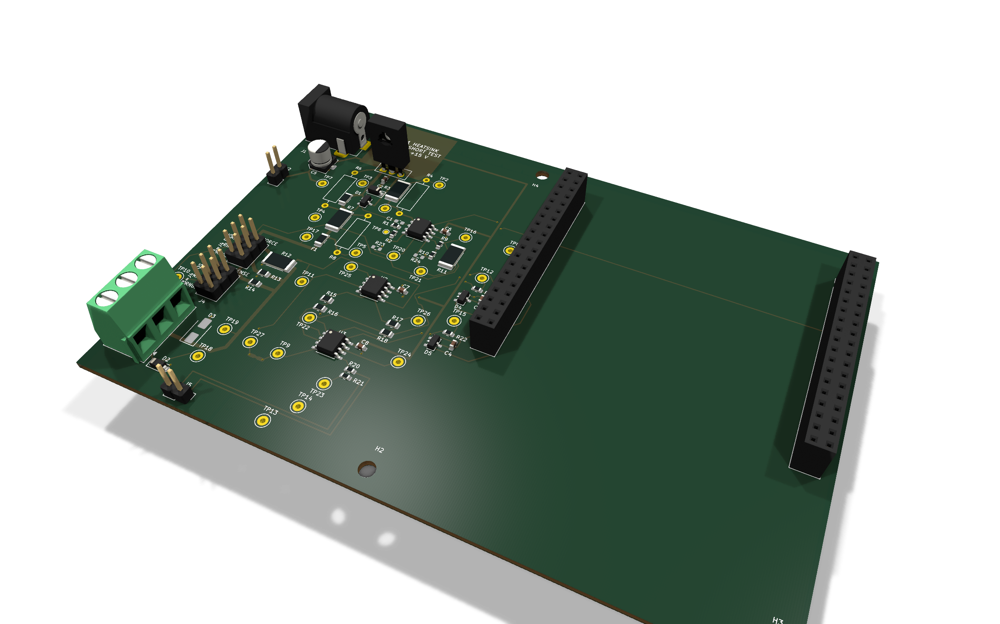
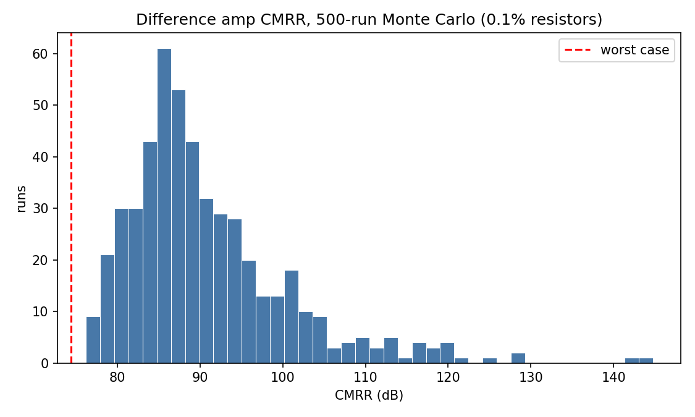
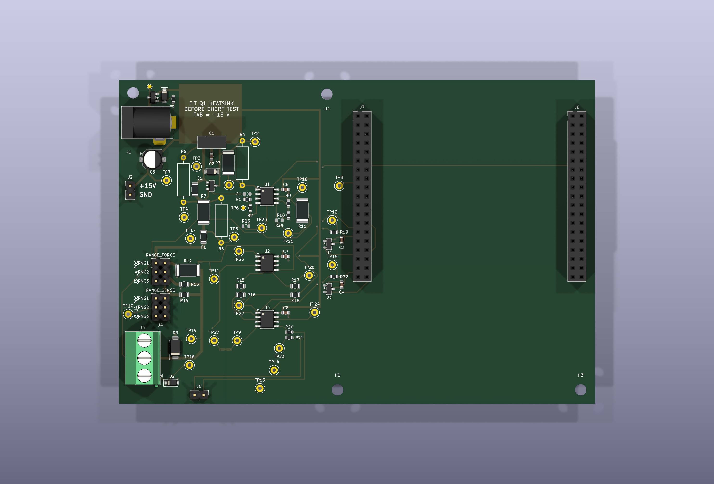

# Curve Tracer

A low-cost semiconductor curve tracer for small-signal MOSFETs and diodes. It
sweeps the voltage across a device, measures the current through it with
four-wire (Kelvin) sensing, and streams the result over USB. A Python host then
fits the device's parameters (threshold voltage, transconductance, channel-length
modulation; diode ideality, saturation current and series resistance) and writes
them out as a SPICE `.model` card. The aim is to close the loop
`device → measurement → model → simulation` on hardware I designed.

It is built as an assembled PCB carrying an STM32 Nucleo-F303RE, with firmware
in C and a Python host.

> **Status, 2026-11-01:** designed, simulated, fabricated and assembled. **No
> board has been powered yet.** Every performance figure below comes from
> simulation and says which one. Bench results go in [Status](#status) as they
> come in.



*KiCad render of the routed board (Pass 2, 2026-10-06), not a photograph. The
Nucleo plugs into the two sockets on the right. Board size 135 × 92 mm, two
layers.*

---

## Design targets

These are targets, not measured performance.

| | Target |
|---|---|
| Sweep voltage | 0–10 V at low current; 9.06–9.73 V ceiling at 50 mA (analysis: set by the PTC fuse's resistance) |
| Sweep current | 0–50 mA |
| Gate step voltage | 0–10 V |
| Current ranges | Three shunts (1 Ω, 100 Ω, 10 kΩ) are fitted. **Only range 1 (0–50 mA) is in the current scope**, with a 40.3 µA LSB |
| Voltage sense | Kelvin-sensed at the device, 0–10 V |
| Output | CSV over USB serial; live plot, parameter extraction and `.model` card on the host |

## Block diagram

```
   Nucleo-F303RE                     Board
  ┌──────────────┐
  │ DAC1_OUT2 PA5├─shunt─► PA6 ─► [×3.32] ─► [OPA2197 + BD139 follower] ─► R_sense ─┬─► R_iso 22Ω ─► PTC ─► shunt ─► DUT drain
  │              │                                ▲      │                         │                        │            │
  │              │                                │   [Q2 current limiter]        │                   [buffered     [Kelvin pair
  │              │                                └─────────── feedback ──────────┘                   diff amp ×20]  ÷4 + buffer]
  │ ADC1  PA0   ◄├──────────────────────────────────────────────────────────────────────────────────────────┘            │
  │ ADC2  PC0   ◄├───────────────────────────────────────────────────────────────────────────────────────────────────────┘
  │ DAC1_OUT1 PA4├─────► [×3.32] ─► [buffer] ─► 1 kΩ ─► DUT gate  (12 V Zener clamp)
  │ USART2 ◄─────┼─► ST-LINK VCP ─► USB ─► Python host
  └──────────────┘                                                     DUT source ─► GND        (SMAJ12A TVS on the drain)
```

Per point: set the gate DAC, set the drain DAC, wait to settle, oversample both
ADCs 64×, send a CSV row. The host recomputes current and voltage from the raw
accumulators and checks them against the firmware's own numbers.

## Design decisions

Each of these is backed by a simulation, a calculation or a datasheet figure.
The full record, part by part, is [`hardware/DECISIONS.md`](hardware/DECISIONS.md);
the reasoning is in [`curve_tracer_blueprint.md`](curve_tracer_blueprint.md).

1. **Isolate the capacitive load; don't compensate it.** The obvious fix, a
   capacitor across the feedback resistor, made the loop *worse* at every value
   from 1 to 100 pF. Instead, a 22 Ω `R_iso` sits outside the loop, and Kelvin
   sensing makes its 1.1 V drop at 50 mA harmless (sims 02, 03).
2. **Model fidelity decided the answer.** With a generic 2N2222 model the
   loop looked unconditionally stable. ST's published BD139 model (f_T ≈ 54 MHz,
   C_jc 36 pF) oscillated immediately. A third-party BD139 model found online
   had placeholder junction capacitances (`CJE = CJC = 1e-11`) and would have
   hidden the problem. A separate false result, 9% overshoot, turned out to be
   a solver timestep artefact. Capping the timestep removed it
   (blueprint §12).
3. **Base resistor 330 Ω, not 680 Ω.** Both are stable in simulation, but
   680 Ω leaves ~44° of implied phase margin, against ~59° for 330 Ω. The
   op-amp's own input capacitance adds a pole the simulation does not contain
   (estimated 5–9 pF), and from 44° that loss is not recoverable (sim 08).
4. **A base-emitter clamp diode.** On a falling edge the op-amp slams to its
   rail while the load holds the emitter up, and V_BE reaches −9 V against the
   BD139's 5 V rating. A 1N4148 holds it to −0.74 V (sims 08, 09).
5. **A hardware current limiter**, Q2 across a 10 Ω `R_sense`, independent of
   the firmware limit. 15 Ω was rejected because its trip point (~49–50 mA)
   falls inside the sweep range (sims 10, 11).
6. **Buffer the difference amplifier's inputs.** Unbuffered, the resistor
   bridge alone draws 475.6 µA through the shunt with nothing connected. That
   is 0.95% of full scale on range 1 and makes range 3 unusable. The design
   went from two to three dual op-amps (sims 06, 07).
7. **0.1% resistors in the difference amp**, because common-mode rejection
   comes from resistor matching alone and cannot be trimmed afterwards (sims 04,
   05).
8. **One board revision, designed for it.** There is a test point on every
   node, footprints for alternate values, headers instead of soldered
   connections, and a footprint for the compensation capacitor, left empty.
   JLCPCB assembled every part on all five boards.
9. **The host slices on *measured* voltage, never the commanded voltage.** At
   one commanded voltage, curves at different currents reach different real
   voltages because of `R_iso`'s drop. Grouping by the command gives a
   convincing but wrong threshold voltage. The diode fit solves n, I_S and R_s
   jointly; a windowed semilog fit was 13% wrong on n at R² = 0.9965
   ([`host/README.md`](host/README.md)).

Two decisions changed when they met reality. They are recorded as rev-2 items,
not hidden:

- **The F303RE has no DAC2.** The board routed the sweep to a pin with no DAC.
  This was found at the first real firmware build. The fix is a jumper on the
  Nucleo from PA5 (DAC1_OUT2) to PA6. PA5 also drives the Nucleo's LED, which
  loads the DAC and may cut sweeps above about 6.6 V (estimated, not yet
  measured; `DECISIONS.md` R2-3).
- **The empty compensation-capacitor footprint assumed hand-fitting**, a
  0603 part, which I could not do reliably. Rev 2 has JLCPCB fit it at the
  measured value (`DECISIONS.md` R2-2).

## Simulation results

**All of these are simulated.** LTspice files are in [`sim/`](sim/), with
per-file detail in [`sim/README.md`](sim/README.md). The sweep-source sims
ran at R_f = 23.3 kΩ; the board has 23.2 kΩ, a 0.4% difference below the
precision of every figure here.

| Question | Result (simulated) | Simulation |
|---|---|---|
| Capacitive load the sweep source tolerates | Without `R_iso`: stable to ~1 nF, oscillating by 2.2 nF. With 22 Ω: clean from 100 pF to 100 nF | LTspice, `sim/03_sweep_source_load_sweep.asc` |
| Small-signal step, 100 nF ‖ 200 Ω, R_B = 330 Ω | 10.34% overshoot, 0.50 µs to 1%, ζ ≈ 0.59 (~59° implied phase margin) | LTspice, `sim/08_sweep_source_rb_sweep.asc` |
| Reverse V_BE on a falling edge, 100 nF load | −7.72 V → −0.73 V (200 Ω load); −8.98 V → −0.74 V (open), with the clamp | LTspice, `sim/08…`, `sim/09_sweep_source_clamped.asc` |
| Current-limiter trip; hard short | 75.2 mA through R_sense; 107.0 mA load; BD139 at 891 mW | LTspice, `sim/11_limit_sizing.asc` |
| Overshoot on recovery from a short, 100 pF load | 14.8 V peak (+48%); back within 1% in 1.9 µs | LTspice, `sim/10_current_limit.asc` |
| Difference-amp CMRR, worst-case 0.1% corner | 74.42 dB | LTspice, `sim/04_diffamp_cmrr.cir` |
| CMRR, 500-run Monte Carlo at 0.1% | median 88.26 dB, p5 79.43 dB, min 76.20 dB | LTspice, `sim/05_diffamp_mc.cir` |
| Phantom current, unbuffered diff amp, no DUT | 475.6 µA at 1 Ω shunt | LTspice, `sim/06_diffamp_loading.cir` |



*Simulated: CMRR over 500 Monte Carlo runs with 0.1% resistors
(`sim/05_diffamp_mc.cir`). LTspice draws uniform, independent tolerances, so
this spread is conservative.*

**What the simulations don't cover.** Sim 08 doesn't model the op-amp's input
capacitance at the inverting node. By hand estimate, it cuts the ~59° margin
to roughly 10–25° with the compensation footprint empty, so **the bare loop
may ring hard or oscillate** at first power-up
([`hardware/CONTINGENCY.md`](hardware/CONTINGENCY.md) §2B). That is what the
first bench test looks for.

### Host software, closed loop on a simulated device

`ct_sim` is the real firmware core (sweep engine, CSV writer, command parser,
current limit), compiled for the desktop with a modelled device behind it. The
host's tests feed it known parameters, run a sweep, extract the parameters, and
require the same values back. **Simulated, `ct_sim`:**

| Fed in | Recovered |
|---|---|
| V_th = 2.15 V | 2.1502 V (0.2 mV) |
| k = 0.055 A/V² | 0.05506 (0.1%) |
| λ = 0.012 /V | 0.01192 (0.7%) |
| diode n = 1.75 | 1.7605 (0.6%) |
| diode I_S = 2.5 nA | 2.73 nA (9%; quantisation, explained in [`host/README.md`](host/README.md)) |
| diode R_s = 0.6 Ω | 0.5914 Ω (1.4%) |

137 host tests and the firmware unit suites pass against it. That validates
the software path only. It says nothing about the analog hardware.

## PCB



*KiCad render, top view (`hardware/review/pass2/`). The analog section is on the
left, with the Nucleo sockets J7/J8 on the right. Q1's heatsink keep-out is
marked at the top left.*

- The analog-critical nets were routed by hand: the feedback node, the
  inverting input, the base drive, the shunt and Kelvin pairs. The rest was
  autorouted (Freerouting) with those nets locked
  ([`hardware/README.md`](hardware/README.md), *Routing policy*).
- DRC and ERC are clean with schematic parity
  (`hardware/review/pass2/metrics.txt`). `check_topology.py` asserts the
  circuit's topology from the netlist (59 checks) and catches all 14 faults
  its self-test plants, which ERC passes.
- Every net that crosses the ground split, and its distance to the star
  tie: [`p2_split_crossings.png`](hardware/review/pass2/p2_split_crossings.png).

## A bench finding: the ST-LINK serial link on macOS

The first time the host talked to the Nucleo (2026-10-30), every command timed
out. A single host write of **16 bytes or more** stopped the ST-LINK/V2-1's
virtual COM port passing data from host to target until the USB cable was
replugged. This was on firmware V2J33M25, under macOS. Writes of 8 bytes,
5 ms apart, got through. The first write after the ST-LINK enumerates was also
lost.

To rule out the firmware, I read the MCU state over SWD while the link was
wedged. The main loop was idle, USART2 was configured, and no bytes were
reaching the RX pin (PA3). The fault is upstream of the MCU, in the ST-LINK's
USB-to-UART bridge. The fix is host-side: the transport writes in 8-byte
chunks 5 ms apart and opens with a blank line, which the firmware's parser
ignores. A regression test checks that no single write reaches 16 bytes. After
the fix, two hold runs back to back worked after a replug (commit `2debc57`).
An ST-LINK firmware upgrade might also fix it. That is untested.

## Status

**Done**
- LTspice and Monte Carlo analysis of every analog block (above).
- Schematic and two-layer PCB; DRC/ERC clean; topology checker.
- Five boards fabricated and fully assembled by JLCPCB (`hardware/ORDER.md`).
- Firmware builds for the STM32 and runs on the Nucleo; the serial link to
  the host works, after the fix above.
- Host capture, extraction and model generation, tested against `ct_sim`.

**Not done**
- No board has been powered. Bring-up starts with
  [`hardware/MVP_CARD.md`](hardware/MVP_CARD.md): power-up, an oscillation
  check, then one diode I-V curve.
- No real device has been measured, and the closed-loop validation
  (measure → model → LTspice → build → compare, blueprint §6) has not started.
- The short-circuit and thermal test (H4 Block 4) waits on an insulator
  between Q1 and its heatsink.
- Ranges 2 and 3 are fitted but out of current scope.

**Open questions the bench will answer**
- Whether the loop oscillates with the compensation footprint empty
  (above).
- How far the Nucleo LED load on PA5 cuts sweeps above ~6.6 V
  (`DECISIONS.md` R2-3).
- The buffered DAC is guaranteed only from 0.2 V to VDDA − 0.2 V, which is
  0.66–10.29 V after the ×3.32 gain, not 0–10.96 V (blueprint §3.5).

### Block 1 results: first power-up, board 2

*To be filled in from `hardware/MVP_CARD.md`. Pass bands and their
derivation are on the card.* A pass here shows no sustained oscillation
under a DC hold. It does not measure phase margin or ringing (H4 step 5, not
run).

| Measurement | Pass band | Result |
|---|---|---|
| Supply current at power-up | 3–25 mA | _TBD_ |
| Scope baseline at TP3, idle (B) | < 10 mV p-p | _TBD_ |
| Hold 6 V into 100 nF ‖ 200 Ω: p-p at TP3 | ≤ B + 5 mV | _TBD_ |
| … measured V, I | 4.8–5.5 V, 23–29 mA | _TBD_ |
| Hold 6 V, open load: p-p at TP3 | ≤ B + 5 mV | _TBD_ |
| … measured V, I | 5.7–6.2 V, ≤ 0.5 mA | _TBD_ |
| Oscillation frequency, if any | — | _TBD_ |
| **Block 1 verdict** | | _TBD_ |

### First diode I-V (only if Block 1 passes)

| | Result |
|---|---|
| Device | _TBD_ |
| n | _TBD_ |
| I_S | _TBD_ |
| R_s | _TBD_ |

*Plot to be added: `host/h4/mvp_10_diode.png`.*

---

## Repository

`hardware/`: KiCad project, decisions record, bring-up cards, order files ·
`firmware/`: STM32 firmware, host-side simulator `ct_sim`, unit tests ·
`host/`: Python capture, extraction and model generation · `sim/`: LTspice and
Monte Carlo · `docs/`: characterization plans · `curve_tracer_blueprint.md`:
the design document.

## Cost

The first build cost about **$283**: four orders in `hardware/ORDER.md`, with
shipping, duty and tax, excluding the Nucleo-F303RE. Most of that is one-time
setup, stencil and shipping across five boards. **Each additional instrument
is about $31**, including the Nucleo (~$18).

Low unit cost is not the goal. The 0.1% resistors and three OPA2197s add only
a few dollars per board. They are what would make the closed-loop result
credible.
