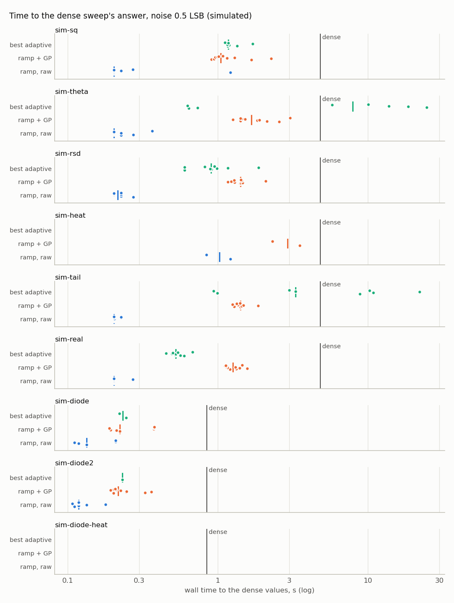
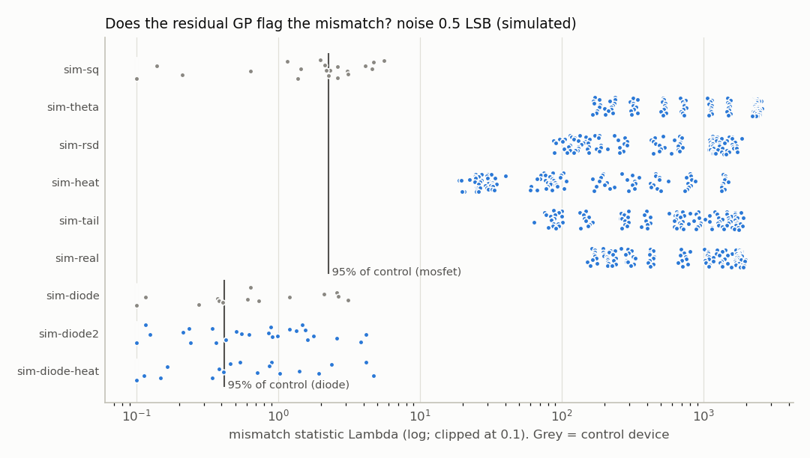
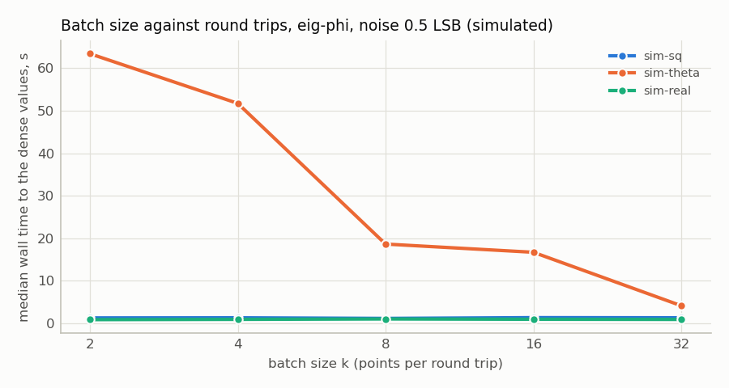
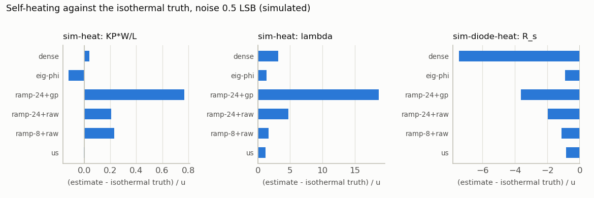

# Adaptive sampling: evaluation results (generated)

**Generated by `ct_host/adaptive/report.py` from `results.csv`. Do not edit by hand; re-run the evaluation instead.**

- generated: 2026-10-20T00:04:10-0700; tasks 510; workers 7; BLAS threads 1
- elapsed: 3089.8 s; command: `--reps 10 --workers 7 --no-report --out ../docs/adaptive`
- rows: 6120; rows with errors: 0
- **Every result here is simulated** (`sim-*` devices, `source` column = synthetic oracle).
- Host compute was measured with several workers sharing the machine, single-threaded BLAS. Treat compute and wall times as conservative.
- Targets are PROVISIONAL (plan Q1): V_th 2 mV, KP 2%, lambda 20%; diode n 1%, I_S 10%, R_s 10%. Budgets 300 (MOSFET) and 50 (diode) points.

## M1-M3 at noise 0 LSB

Medians over seeds. `to_dense` = first point count (and wall time) from which every gated parameter stays within the dense sweep's stated uncertainty `sqrt(se^2 + (spread/2)^2)`; for ramps, the cheapest ramp that is within it. `reached` = fraction of seeds that got there. `cov_*` = fraction of gated parameter estimates within 2 combined sigma of the dense value / of the generative truth (truth: control devices only are meaningful).

| device | design | points | wall_s | to_dense_pts | to_dense_s | reached | stop | cov_dense | cov_truth |
|---|---|---|---|---|---|---|---|---|---|
| sim-sq | dense (n=200) | 1200.00 | 4.82 | -- | -- | -- | -- | -- | 1.00 |
| sim-sq | best ramp, raw | -- | -- | 36.00 | 0.23 | 1.00 | -- | 0.99 | 0.97 |
| sim-sq | best ramp + GP | -- | -- | 30.00 | 1.05 | 1.00 | -- | 1.00 | 0.98 |
| sim-sq | us | 30.00 | 1.20 | 30.00 | 1.19 | 0.70 | target_met 9, budget 1 | 1.00 | 0.97 |
| sim-sq | eig-theta | 30.00 | 1.20 | 30.00 | 1.19 | 0.70 | target_met 9, budget 1 | 1.00 | 0.93 |
| sim-sq | eig-phi | 30.00 | 1.18 | 30.00 | 1.16 | 0.60 | target_met 10 | 1.00 | 0.97 |
| sim-sq | wa-phi | 30.00 | 1.21 | 30.00 | 1.23 | 0.70 | target_met 10 | 1.00 | 0.90 |
| sim-theta | dense (n=200) | 1200.00 | 4.82 | -- | -- | -- | -- | -- | 0.67 |
| sim-theta | best ramp, raw | -- | -- | 30.00 | 0.20 | 1.00 | -- | 1.00 | 0.67 |
| sim-theta | best ramp + GP | -- | -- | 30.00 | 1.20 | 1.00 | -- | 1.00 | 0.66 |
| sim-theta | us | 300.00 | 29.26 | 30.00 | 0.64 | 0.90 | budget 10 | 1.00 | 0.67 |
| sim-theta | eig-theta | 300.00 | 24.54 | 30.00 | 0.58 | 0.70 | budget 10 | 0.93 | 0.60 |
| sim-theta | eig-phi | 300.00 | 37.45 | 30.00 | 1.03 | 1.00 | budget 10 | 1.00 | 0.67 |
| sim-theta | wa-phi | 300.00 | 37.75 | 46.00 | 2.10 | 1.00 | budget 10 | 1.00 | 0.60 |
| sim-rsd | dense (n=200) | 1200.00 | 4.82 | -- | -- | -- | -- | -- | 0.40 |
| sim-rsd | best ramp, raw | -- | -- | 30.00 | 0.20 | 1.00 | -- | 0.99 | 0.48 |
| sim-rsd | best ramp + GP | -- | -- | 30.00 | 1.30 | 1.00 | -- | 1.00 | 0.35 |
| sim-rsd | us | 300.00 | 26.13 | 30.00 | 0.58 | 0.90 | budget 10 | 1.00 | 0.33 |
| sim-rsd | eig-theta | 300.00 | 28.15 | 190.00 | 11.17 | 0.80 | budget 10 | 1.00 | 0.40 |
| sim-rsd | eig-phi | 300.00 | 42.93 | 38.00 | 1.56 | 0.90 | budget 10 | 1.00 | 0.33 |
| sim-rsd | wa-phi | 300.00 | 40.19 | 38.00 | 1.65 | 1.00 | budget 10 | 1.00 | 0.33 |
| sim-heat | dense (n=200) | 1200.00 | 4.82 | -- | -- | -- | -- | -- | 0.67 |
| sim-heat | best ramp, raw | -- | -- | 96.00 | 0.46 | 0.50 | -- | 0.93 | 0.81 |
| sim-heat | best ramp + GP | -- | -- | 288.00 | 3.61 | 0.40 | -- | 0.87 | 0.68 |
| sim-heat | us | 30.00 | 1.49 | -- | -- | 0.00 | target_met 10 | 0.70 | 0.73 |
| sim-heat | eig-theta | 30.00 | 1.50 | -- | -- | 0.00 | target_met 10 | 0.70 | 0.80 |
| sim-heat | eig-phi | 30.00 | 1.55 | -- | -- | 0.00 | target_met 10 | 0.70 | 0.77 |
| sim-heat | wa-phi | 30.00 | 1.49 | -- | -- | 0.00 | target_met 10 | 0.70 | 0.77 |
| sim-tail | dense (n=200) | 1200.00 | 4.82 | -- | -- | -- | -- | -- | 0.83 |
| sim-tail | best ramp, raw | -- | -- | 48.00 | 0.27 | 1.00 | -- | 0.99 | 0.92 |
| sim-tail | best ramp + GP | -- | -- | 30.00 | 1.20 | 1.00 | -- | 1.00 | 0.66 |
| sim-tail | us | 300.00 | 21.59 | 30.00 | 0.60 | 0.90 | budget 10 | 1.00 | 0.63 |
| sim-tail | eig-theta | 300.00 | 23.81 | 30.00 | 0.63 | 0.80 | budget 10 | 1.00 | 0.57 |
| sim-tail | eig-phi | 300.00 | 36.89 | 54.00 | 2.69 | 1.00 | budget 10 | 1.00 | 0.63 |
| sim-tail | wa-phi | 300.00 | 38.51 | 30.00 | 0.99 | 1.00 | budget 10 | 1.00 | 0.57 |
| sim-real | dense (n=200) | 1200.00 | 4.82 | -- | -- | -- | -- | -- | 0.67 |
| sim-real | best ramp, raw | -- | -- | 36.00 | 0.23 | 1.00 | -- | 1.00 | 0.57 |
| sim-real | best ramp + GP | -- | -- | 33.00 | 1.36 | 1.00 | -- | 1.00 | 0.47 |
| sim-real | us | 300.00 | 25.11 | 66.00 | 2.29 | 0.20 | budget 10 | 1.00 | 0.07 |
| sim-real | eig-theta | 300.00 | 22.55 | 226.00 | 13.43 | 0.40 | budget 10 | 1.00 | 0.30 |
| sim-real | eig-phi | 300.00 | 35.62 | 70.00 | 4.18 | 0.50 | budget 10 | 1.00 | 0.17 |
| sim-real | wa-phi | 300.00 | 34.58 | 78.00 | 6.88 | 0.10 | budget 10 | 1.00 | 0.13 |
| sim-diode | dense (n=200) | 200.00 | 0.85 | -- | -- | -- | -- | -- | 1.00 |
| sim-diode | best ramp, raw | -- | -- | 14.00 | 0.14 | 0.80 | -- | 0.97 | 0.96 |
| sim-diode | best ramp + GP | -- | -- | 16.00 | 0.25 | 0.80 | -- | 0.97 | 0.96 |
| sim-diode | us | 28.00 | 0.53 | 24.00 | 0.37 | 0.30 | target_met 9, budget 1 | 0.93 | 0.93 |
| sim-diode | eig-theta | 28.00 | 0.47 | 44.00 | 0.70 | 0.10 | target_met 8, budget 2 | 1.00 | 0.93 |
| sim-diode | eig-phi | 24.00 | 0.48 | 20.00 | 0.34 | 0.30 | target_met 10 | 1.00 | 0.97 |
| sim-diode | wa-phi | 22.00 | 0.43 | 16.00 | 0.26 | 0.10 | target_met 8, budget 2 | 1.00 | 1.00 |
| sim-diode2 | dense (n=200) | 200.00 | 0.85 | -- | -- | -- | -- | -- | 0.33 |
| sim-diode2 | best ramp, raw | -- | -- | 32.00 | 0.21 | 1.00 | -- | 0.90 | 0.37 |
| sim-diode2 | best ramp + GP | -- | -- | 24.00 | 0.29 | 0.90 | -- | 0.97 | 0.41 |
| sim-diode2 | us | 16.00 | 0.39 | 40.00 | 0.63 | 0.10 | target_met 8, budget 2 | 0.80 | 0.20 |
| sim-diode2 | eig-theta | 22.00 | 0.52 | 20.00 | 0.31 | 0.10 | target_met 8, budget 2 | 0.90 | 0.23 |
| sim-diode2 | eig-phi | 16.00 | 0.34 | 8.00 | 0.19 | 0.10 | target_met 10 | 0.97 | 0.30 |
| sim-diode2 | wa-phi | 16.00 | 0.39 | 24.00 | 0.50 | 0.30 | target_met 8, budget 2 | 1.00 | 0.30 |
| sim-diode-heat | dense (n=200) | 200.00 | 0.85 | -- | -- | -- | -- | -- | 0.50 |
| sim-diode-heat | best ramp, raw | -- | -- | -- | -- | 0.00 | -- | 0.92 | 0.94 |
| sim-diode-heat | best ramp + GP | -- | -- | -- | -- | 0.00 | -- | 0.88 | 0.93 |
| sim-diode-heat | us | 28.00 | 0.55 | -- | -- | 0.00 | target_met 8, budget 2 | 0.63 | 0.87 |
| sim-diode-heat | eig-theta | 38.00 | 0.64 | -- | -- | 0.00 | target_met 6, budget 4 | 0.73 | 1.00 |
| sim-diode-heat | eig-phi | 26.00 | 0.50 | -- | -- | 0.00 | target_met 8, budget 2 | 0.67 | 0.83 |
| sim-diode-heat | wa-phi | 22.00 | 0.46 | -- | -- | 0.00 | target_met 7, budget 3 | 0.73 | 1.00 |

## M1-M3 at noise 0.5 LSB

Medians over seeds. `to_dense` = first point count (and wall time) from which every gated parameter stays within the dense sweep's stated uncertainty `sqrt(se^2 + (spread/2)^2)`; for ramps, the cheapest ramp that is within it. `reached` = fraction of seeds that got there. `cov_*` = fraction of gated parameter estimates within 2 combined sigma of the dense value / of the generative truth (truth: control devices only are meaningful).

| device | design | points | wall_s | to_dense_pts | to_dense_s | reached | stop | cov_dense | cov_truth |
|---|---|---|---|---|---|---|---|---|---|
| sim-sq | dense (n=200) | 1200.00 | 4.82 | -- | -- | -- | -- | -- | 1.00 |
| sim-sq | best ramp, raw | -- | -- | 30.00 | 0.20 | 0.90 | -- | 1.00 | 1.00 |
| sim-sq | best ramp + GP | -- | -- | 30.00 | 1.05 | 1.00 | -- | 1.00 | 0.97 |
| sim-sq | us | 30.00 | 1.18 | 30.00 | 1.26 | 0.30 | target_met 10 | 0.97 | 0.97 |
| sim-sq | eig-theta | 30.00 | 1.23 | 30.00 | 1.28 | 0.40 | target_met 10 | 1.00 | 1.00 |
| sim-sq | eig-phi | 30.00 | 1.18 | 30.00 | 1.19 | 0.50 | target_met 10 | 1.00 | 0.97 |
| sim-sq | wa-phi | 30.00 | 1.19 | 30.00 | 1.18 | 0.70 | target_met 10 | 1.00 | 1.00 |
| sim-theta | dense (n=200) | 1200.00 | 4.82 | -- | -- | -- | -- | -- | 0.67 |
| sim-theta | best ramp, raw | -- | -- | 30.00 | 0.20 | 1.00 | -- | 1.00 | 0.65 |
| sim-theta | best ramp + GP | -- | -- | 33.00 | 1.68 | 1.00 | -- | 0.99 | 0.65 |
| sim-theta | us | 300.00 | 26.23 | 150.00 | 7.92 | 0.80 | budget 10 | 1.00 | 0.67 |
| sim-theta | eig-theta | 300.00 | 29.18 | 246.00 | 17.27 | 0.50 | budget 10 | 1.00 | 0.67 |
| sim-theta | eig-phi | 300.00 | 38.00 | 178.00 | 18.44 | 0.80 | budget 10 | 0.97 | 0.63 |
| sim-theta | wa-phi | 300.00 | 35.75 | 110.00 | 8.65 | 0.60 | budget 10 | 1.00 | 0.67 |
| sim-rsd | dense (n=200) | 1200.00 | 4.82 | -- | -- | -- | -- | -- | 0.33 |
| sim-rsd | best ramp, raw | -- | -- | 33.00 | 0.22 | 1.00 | -- | 1.00 | 0.35 |
| sim-rsd | best ramp + GP | -- | -- | 48.00 | 1.42 | 1.00 | -- | 0.99 | 0.34 |
| sim-rsd | us | 300.00 | 27.52 | 38.00 | 0.91 | 1.00 | budget 10 | 1.00 | 0.33 |
| sim-rsd | eig-theta | 300.00 | 25.08 | 214.00 | 14.18 | 0.10 | budget 10 | 1.00 | 0.50 |
| sim-rsd | eig-phi | 300.00 | 37.57 | 78.00 | 6.10 | 0.60 | budget 10 | 0.97 | 0.33 |
| sim-rsd | wa-phi | 300.00 | 39.48 | 50.00 | 3.01 | 0.40 | budget 10 | 0.87 | 0.33 |
| sim-heat | dense (n=200) | 1200.00 | 4.82 | -- | -- | -- | -- | -- | 0.67 |
| sim-heat | best ramp, raw | -- | -- | 240.00 | 1.03 | 0.20 | -- | 0.84 | 0.74 |
| sim-heat | best ramp + GP | -- | -- | 240.00 | 2.92 | 0.20 | -- | 0.81 | 0.59 |
| sim-heat | us | 30.00 | 1.21 | -- | -- | 0.00 | target_met 10 | 0.73 | 0.97 |
| sim-heat | eig-theta | 30.00 | 1.24 | -- | -- | 0.00 | target_met 10 | 0.73 | 1.00 |
| sim-heat | eig-phi | 30.00 | 1.21 | -- | -- | 0.00 | target_met 10 | 0.73 | 0.97 |
| sim-heat | wa-phi | 30.00 | 1.20 | -- | -- | 0.00 | target_met 10 | 0.73 | 0.97 |
| sim-tail | dense (n=200) | 1200.00 | 4.82 | -- | -- | -- | -- | -- | 1.00 |
| sim-tail | best ramp, raw | -- | -- | 30.00 | 0.20 | 1.00 | -- | 1.00 | 1.00 |
| sim-tail | best ramp + GP | -- | -- | 30.00 | 1.41 | 1.00 | -- | 1.00 | 0.66 |
| sim-tail | us | 300.00 | 23.52 | 134.00 | 5.13 | 0.90 | budget 10 | 1.00 | 0.63 |
| sim-tail | eig-theta | 300.00 | 26.06 | 166.00 | 8.47 | 0.70 | budget 10 | 1.00 | 0.67 |
| sim-tail | eig-phi | 300.00 | 38.04 | 62.00 | 3.29 | 0.90 | budget 10 | 1.00 | 0.67 |
| sim-tail | wa-phi | 300.00 | 36.27 | 110.00 | 9.31 | 0.80 | budget 10 | 1.00 | 0.67 |
| sim-real | dense (n=200) | 1200.00 | 4.82 | -- | -- | -- | -- | -- | 0.67 |
| sim-real | best ramp, raw | -- | -- | 30.00 | 0.20 | 1.00 | -- | 1.00 | 0.53 |
| sim-real | best ramp + GP | -- | -- | 30.00 | 1.26 | 1.00 | -- | 1.00 | 0.31 |
| sim-real | us | 300.00 | 21.37 | 30.00 | 0.53 | 0.90 | budget 10 | 1.00 | 0.07 |
| sim-real | eig-theta | 300.00 | 24.54 | 182.00 | 9.96 | 0.70 | budget 10 | 1.00 | 0.43 |
| sim-real | eig-phi | 300.00 | 38.75 | 30.00 | 1.00 | 0.70 | budget 10 | 1.00 | 0.13 |
| sim-real | wa-phi | 300.00 | 32.75 | 30.00 | 0.96 | 0.90 | budget 10 | 1.00 | 0.03 |
| sim-diode | dense (n=200) | 200.00 | 0.85 | -- | -- | -- | -- | -- | 1.00 |
| sim-diode | best ramp, raw | -- | -- | 12.00 | 0.13 | 0.50 | -- | 0.98 | 0.93 |
| sim-diode | best ramp + GP | -- | -- | 12.00 | 0.22 | 0.70 | -- | 1.00 | 1.00 |
| sim-diode | us | 8.00 | 0.24 | 8.00 | 0.24 | 0.30 | target_met 10 | 1.00 | 1.00 |
| sim-diode | eig-theta | 8.00 | 0.24 | -- | -- | 0.00 | target_met 10 | 0.80 | 0.83 |
| sim-diode | eig-phi | 8.00 | 0.23 | 8.00 | 0.23 | 0.20 | target_met 10 | 0.93 | 1.00 |
| sim-diode | wa-phi | 8.00 | 0.24 | 8.00 | 0.23 | 0.20 | target_met 10 | 0.90 | 0.90 |
| sim-diode2 | dense (n=200) | 200.00 | 0.85 | -- | -- | -- | -- | -- | 0.17 |
| sim-diode2 | best ramp, raw | -- | -- | 8.00 | 0.12 | 0.70 | -- | 0.95 | 0.27 |
| sim-diode2 | best ramp + GP | -- | -- | 8.00 | 0.22 | 1.00 | -- | 1.00 | 0.35 |
| sim-diode2 | us | 8.00 | 0.25 | 8.00 | 0.24 | 0.50 | target_met 10 | 1.00 | 0.30 |
| sim-diode2 | eig-theta | 8.00 | 0.26 | 8.00 | 0.23 | 0.10 | target_met 10 | 0.93 | 0.27 |
| sim-diode2 | eig-phi | 8.00 | 0.25 | 8.00 | 0.24 | 0.30 | target_met 10 | 1.00 | 0.30 |
| sim-diode2 | wa-phi | 8.00 | 0.24 | 8.00 | 0.25 | 0.30 | target_met 10 | 1.00 | 0.27 |
| sim-diode-heat | dense (n=200) | 200.00 | 0.85 | -- | -- | -- | -- | -- | 0.37 |
| sim-diode-heat | best ramp, raw | -- | -- | -- | -- | 0.00 | -- | 0.64 | 0.73 |
| sim-diode-heat | best ramp + GP | -- | -- | -- | -- | 0.00 | -- | 0.68 | 0.78 |
| sim-diode-heat | us | 8.00 | 0.26 | -- | -- | 0.00 | target_met 10 | 0.67 | 1.00 |
| sim-diode-heat | eig-theta | 8.00 | 0.25 | -- | -- | 0.00 | target_met 10 | 0.57 | 0.87 |
| sim-diode-heat | eig-phi | 8.00 | 0.25 | -- | -- | 0.00 | target_met 10 | 0.67 | 0.93 |
| sim-diode-heat | wa-phi | 8.00 | 0.25 | -- | -- | 0.00 | target_met 10 | 0.63 | 1.00 |

*Dots are seeds and the tick is their median. A row with no dots never reached the dense values. The vertical line is the dense sweep's own wall time.*

## M1-M3 at noise 2 LSB

Medians over seeds. `to_dense` = first point count (and wall time) from which every gated parameter stays within the dense sweep's stated uncertainty `sqrt(se^2 + (spread/2)^2)`; for ramps, the cheapest ramp that is within it. `reached` = fraction of seeds that got there. `cov_*` = fraction of gated parameter estimates within 2 combined sigma of the dense value / of the generative truth (truth: control devices only are meaningful).

| device | design | points | wall_s | to_dense_pts | to_dense_s | reached | stop | cov_dense | cov_truth |
|---|---|---|---|---|---|---|---|---|---|
| sim-sq | dense (n=200) | 1200.00 | 4.82 | -- | -- | -- | -- | -- | 1.00 |
| sim-sq | best ramp, raw | -- | -- | 36.00 | 0.23 | 1.00 | -- | 1.00 | 0.99 |
| sim-sq | best ramp + GP | -- | -- | 36.00 | 1.06 | 1.00 | -- | 1.00 | 0.98 |
| sim-sq | us | 30.00 | 1.36 | 30.00 | 1.20 | 0.30 | target_met 10 | 1.00 | 1.00 |
| sim-sq | eig-theta | 30.00 | 1.18 | 30.00 | 1.14 | 0.20 | target_met 10 | 1.00 | 0.97 |
| sim-sq | eig-phi | 30.00 | 1.12 | 30.00 | 1.10 | 0.50 | target_met 10 | 1.00 | 0.90 |
| sim-sq | wa-phi | 30.00 | 1.11 | 30.00 | 1.09 | 0.50 | target_met 10 | 1.00 | 1.00 |
| sim-theta | dense (n=200) | 1200.00 | 4.82 | -- | -- | -- | -- | -- | 0.67 |
| sim-theta | best ramp, raw | -- | -- | 33.00 | 0.22 | 1.00 | -- | 1.00 | 0.67 |
| sim-theta | best ramp + GP | -- | -- | 42.00 | 1.38 | 1.00 | -- | 0.98 | 0.64 |
| sim-theta | us | 300.00 | 27.77 | 198.00 | 11.11 | 0.70 | budget 10 | 1.00 | 0.67 |
| sim-theta | eig-theta | 300.00 | 27.22 | 62.00 | 2.24 | 0.80 | budget 10 | 1.00 | 0.67 |
| sim-theta | eig-phi | 300.00 | 39.29 | 158.00 | 13.07 | 0.90 | budget 10 | 0.97 | 0.63 |
| sim-theta | wa-phi | 300.00 | 37.29 | 54.00 | 3.23 | 0.50 | budget 10 | 0.97 | 0.63 |
| sim-rsd | dense (n=200) | 1200.00 | 4.82 | -- | -- | -- | -- | -- | 0.33 |
| sim-rsd | best ramp, raw | -- | -- | 33.00 | 0.22 | 1.00 | -- | 1.00 | 0.48 |
| sim-rsd | best ramp + GP | -- | -- | 30.00 | 1.37 | 1.00 | -- | 1.00 | 0.34 |
| sim-rsd | us | 300.00 | 28.90 | 38.00 | 0.89 | 0.90 | budget 10 | 1.00 | 0.33 |
| sim-rsd | eig-theta | 300.00 | 28.27 | 170.00 | 10.65 | 0.40 | budget 10 | 1.00 | 0.50 |
| sim-rsd | eig-phi | 300.00 | 36.62 | 126.00 | 10.46 | 0.80 | budget 10 | 1.00 | 0.33 |
| sim-rsd | wa-phi | 300.00 | 38.44 | 54.00 | 2.69 | 0.70 | budget 10 | 0.97 | 0.33 |
| sim-heat | dense (n=200) | 1200.00 | 4.82 | -- | -- | -- | -- | -- | 0.67 |
| sim-heat | best ramp, raw | -- | -- | 288.00 | 1.21 | 0.40 | -- | 0.90 | 0.82 |
| sim-heat | best ramp + GP | -- | -- | 192.00 | 2.22 | 0.10 | -- | 0.82 | 0.67 |
| sim-heat | us | 30.00 | 1.22 | -- | -- | 0.00 | target_met 10 | 0.70 | 0.87 |
| sim-heat | eig-theta | 30.00 | 1.31 | -- | -- | 0.00 | target_met 10 | 0.67 | 0.80 |
| sim-heat | eig-phi | 30.00 | 1.42 | -- | -- | 0.00 | target_met 10 | 0.67 | 0.87 |
| sim-heat | wa-phi | 30.00 | 1.36 | -- | -- | 0.00 | target_met 10 | 0.70 | 0.70 |
| sim-tail | dense (n=200) | 1200.00 | 4.83 | -- | -- | -- | -- | -- | 0.93 |
| sim-tail | best ramp, raw | -- | -- | 30.00 | 0.20 | 1.00 | -- | 1.00 | 0.93 |
| sim-tail | best ramp + GP | -- | -- | 30.00 | 1.39 | 1.00 | -- | 0.99 | 0.66 |
| sim-tail | us | 300.00 | 25.75 | 118.00 | 5.45 | 0.80 | budget 10 | 1.00 | 0.67 |
| sim-tail | eig-theta | 300.00 | 26.96 | 54.00 | 1.49 | 0.70 | budget 10 | 1.00 | 0.67 |
| sim-tail | eig-phi | 300.00 | 38.69 | 158.00 | 13.61 | 1.00 | budget 10 | 1.00 | 0.67 |
| sim-tail | wa-phi | 300.00 | 36.72 | 102.00 | 5.94 | 0.90 | budget 10 | 1.00 | 0.67 |
| sim-real | dense (n=200) | 1200.00 | 4.82 | -- | -- | -- | -- | -- | 0.67 |
| sim-real | best ramp, raw | -- | -- | 30.00 | 0.20 | 1.00 | -- | 1.00 | 0.57 |
| sim-real | best ramp + GP | -- | -- | 30.00 | 1.28 | 1.00 | -- | 1.00 | 0.48 |
| sim-real | us | 300.00 | 24.31 | 30.00 | 0.60 | 0.30 | budget 10 | 1.00 | 0.07 |
| sim-real | eig-theta | 300.00 | 25.56 | 158.00 | 8.50 | 0.40 | budget 10 | 1.00 | 0.50 |
| sim-real | eig-phi | 300.00 | 35.94 | 30.00 | 0.97 | 0.30 | budget 10 | 1.00 | 0.17 |
| sim-real | wa-phi | 300.00 | 31.01 | 30.00 | 0.87 | 0.40 | budget 10 | 1.00 | 0.13 |
| sim-diode | dense (n=200) | 200.00 | 0.85 | -- | -- | -- | -- | -- | 1.00 |
| sim-diode | best ramp, raw | -- | -- | 20.00 | 0.16 | 0.80 | -- | 0.96 | 0.96 |
| sim-diode | best ramp + GP | -- | -- | 16.00 | 0.26 | 0.70 | -- | 0.99 | 0.97 |
| sim-diode | us | 18.00 | 0.41 | 12.00 | 0.24 | 0.10 | target_met 10 | 1.00 | 1.00 |
| sim-diode | eig-theta | 24.00 | 0.45 | 16.00 | 0.27 | 0.40 | target_met 10 | 0.93 | 0.93 |
| sim-diode | eig-phi | 24.00 | 0.44 | 20.00 | 0.32 | 0.20 | target_met 10 | 0.93 | 0.90 |
| sim-diode | wa-phi | 16.00 | 0.36 | 12.00 | 0.28 | 0.50 | target_met 10 | 1.00 | 1.00 |
| sim-diode2 | dense (n=200) | 200.00 | 0.85 | -- | -- | -- | -- | -- | 0.33 |
| sim-diode2 | best ramp, raw | -- | -- | 12.00 | 0.13 | 0.70 | -- | 0.92 | 0.37 |
| sim-diode2 | best ramp + GP | -- | -- | 12.00 | 0.24 | 0.90 | -- | 0.99 | 0.39 |
| sim-diode2 | us | 12.00 | 0.32 | 10.00 | 0.25 | 0.20 | target_met 10 | 1.00 | 0.33 |
| sim-diode2 | eig-theta | 22.00 | 0.45 | 14.00 | 0.26 | 0.20 | target_met 10 | 0.93 | 0.33 |
| sim-diode2 | eig-phi | 16.00 | 0.36 | 12.00 | 0.23 | 0.40 | target_met 10 | 1.00 | 0.33 |
| sim-diode2 | wa-phi | 12.00 | 0.32 | 12.00 | 0.26 | 0.40 | target_met 10 | 1.00 | 0.30 |
| sim-diode-heat | dense (n=200) | 200.00 | 0.85 | -- | -- | -- | -- | -- | 0.67 |
| sim-diode-heat | best ramp, raw | -- | -- | -- | -- | 0.00 | -- | 0.91 | 0.87 |
| sim-diode-heat | best ramp + GP | -- | -- | -- | -- | 0.00 | -- | 0.90 | 0.92 |
| sim-diode-heat | us | 20.00 | 0.44 | -- | -- | 0.00 | target_met 10 | 0.70 | 1.00 |
| sim-diode-heat | eig-theta | 22.00 | 0.43 | -- | -- | 0.00 | target_met 9, budget 1 | 0.73 | 1.00 |
| sim-diode-heat | eig-phi | 20.00 | 0.49 | -- | -- | 0.00 | target_met 10 | 0.70 | 0.83 |
| sim-diode-heat | wa-phi | 16.00 | 0.36 | -- | -- | 0.00 | target_met 10 | 0.77 | 1.00 |

## M3: calibration against the truth (control devices)

Every GP-bearing design (adaptive, and sparse ramps + GP), gated parameters pooled, z = (estimate - generative value) / stated u. Nominal: 0.683 within 1 sigma, 0.954 within 2. Noise 0 is the undithered case, where oversampling does not reduce quantisation error.

| noise_lsb | device | estimates | within 1 sigma | within 2 sigma | median |z| |
|---|---|---|---|---|---|
| 0.00 | sim-sq | 360 | 0.77 | 0.97 | 0.55 |
| 0.00 | sim-diode | 360 | 0.72 | 0.96 | 0.67 |
| 0.50 | sim-sq | 360 | 0.79 | 0.98 | 0.56 |
| 0.50 | sim-diode | 360 | 0.79 | 0.97 | 0.52 |
| 2.00 | sim-sq | 360 | 0.77 | 0.98 | 0.47 |
| 2.00 | sim-diode | 360 | 0.76 | 0.97 | 0.60 |

## The phase-2 gate (plan §4.6) at noise 0.5 LSB

| device | best adaptive | to dense, s | dense wall, s | 1: <= 50% dense | no-firmware best | its time to dense, s | 2: >= 30% under it | 3: coverage | 3: >= 90% | 4: flag TPR |
|---|---|---|---|---|---|---|---|---|---|---|
| sim-theta | us | 7.92 | 4.82 | no | ramp+raw | 0.20 | no | 1.00 | yes | 1.00 |
| sim-rsd | us | 0.91 | 4.82 | yes | ramp+raw | 0.22 | no | 1.00 | yes | 1.00 |
| sim-heat | -- | -- | 4.82 | no | ramp+raw | 1.03 | no | -- | no | 1.00 |
| sim-tail | eig-phi | 3.29 | 4.82 | no | ramp+raw | 0.20 | no | 1.00 | yes | 1.00 |
| sim-real | us | 0.53 | 4.82 | yes | ramp+raw | 0.20 | no | 1.00 | yes | 1.00 |
| sim-diode2 | eig-theta | 0.23 | 0.85 | yes | ramp+raw | 0.12 | no | 0.93 | yes | 0.15 |
| sim-diode-heat | -- | -- | 0.85 | no | -- | -- | no | -- | no | 0.07 |

## M5: mismatch statistic at noise 0.5 LSB

Threshold = 95th percentile of Lambda on the control device of the same kind, over every GP-bearing design at this noise, from even seeds; `tpr`/`fpr` are measured on odd seeds (held out). `map` columns: the residual map (|E delta| > 3 sd given theta and > 1 LSB) against where the noiseless truth departs from its best model fit by > 1 LSB (the same magnitude floor); the 3-LSB fraction is shown beside it.

| device | runs | held-out runs | lambda median | lambda p5 | threshold | tpr | fpr | map flagged | map precision | map recall | true mismatch frac (1 LSB) | (3 LSB) | residual max, LSB |
|---|---|---|---|---|---|---|---|---|---|---|---|---|---|
| sim-sq | 120 | 60 | -3.04 | -5.02 | 2.27 | -- | 0.10 | 0.00 | -- | -- | 0.00 | 0.00 | 0.11 |
| sim-theta | 120 | 60 | 1299.39 | 182.59 | 2.27 | 1.00 | -- | 0.82 | 0.93 | 0.81 | 0.91 | 0.77 | 74.94 |
| sim-rsd | 120 | 60 | 561.77 | 103.85 | 2.27 | 1.00 | -- | 0.79 | 0.68 | 0.74 | 0.72 | 0.08 | 26.87 |
| sim-heat | 120 | 60 | 86.95 | 24.28 | 2.27 | 1.00 | -- | 0.61 | 0.78 | 0.57 | 0.83 | 0.38 | 9.43 |
| sim-tail | 120 | 60 | 680.54 | 84.93 | 2.27 | 1.00 | -- | 0.99 | 0.17 | 1.00 | 0.17 | 0.00 | 29.60 |
| sim-real | 120 | 60 | 908.74 | 171.13 | 2.27 | 1.00 | -- | 0.87 | 0.93 | 0.88 | 0.94 | 0.82 | 34.47 |
| sim-diode | 120 | 60 | -1.20 | -3.21 | 0.42 | -- | 0.08 | 0.00 | -- | -- | 0.00 | 0.00 | 0.07 |
| sim-diode2 | 120 | 60 | -0.88 | -3.29 | 0.42 | 0.15 | -- | 0.00 | -- | -- | 0.00 | 0.00 | 0.08 |
| sim-diode-heat | 120 | 60 | -1.15 | -3.43 | 0.42 | 0.07 | -- | 0.00 | -- | -- | 0.00 | 0.00 | 0.07 |

### Flag rate against severity (ramp-24 + GP)

| device | severity | runs | lambda median | flagged | true mismatch frac |
|---|---|---|---|---|---|
| sim-diode2 | {"i_s2": 2e-07} | 5 | -1.48 | 0.00 | 0.00 |
| sim-diode2 | {"i_s2": 2e-09} | 5 | -1.37 | 0.00 | 0.00 |
| sim-diode2 | {"i_s2": 2e-10} | 5 | -1.12 | 0.00 | 0.00 |
| sim-rsd | {"r_s": 0.25, "r_d": 0.25} | 5 | 324.88 | 1.00 | 0.03 |
| sim-rsd | {"r_s": 0.5, "r_d": 0.5} | 5 | 411.12 | 1.00 | 0.53 |
| sim-rsd | {"r_s": 2.0, "r_d": 2.0} | 5 | 488.21 | 1.00 | 0.83 |
| sim-tail | {"inversion_n": 1.2} | 5 | 404.77 | 1.00 | 0.16 |
| sim-tail | {"inversion_n": 1.8} | 5 | 764.11 | 1.00 | 0.18 |
| sim-theta | {"theta": 0.02} | 5 | 553.88 | 1.00 | 0.08 |
| sim-theta | {"theta": 0.05} | 5 | 811.41 | 1.00 | 0.77 |
| sim-theta | {"theta": 0.1} | 5 | 956.68 | 1.00 | 0.82 |
| sim-theta | {"theta": 0.4} | 5 | 1227.46 | 1.00 | 0.98 |

## M4: curve reconstruction at noise 0.5 LSB

RMSE and max error of the posterior mean against the noiseless curve at the dense design's points (under the dense ramp's heating), in output LSB; `band95` = fraction inside the 95% band; `iso_rmse` = against the isothermal curve.

| device | design | points | rmse_lsb | max_lsb | band95 | iso_rmse_lsb |
|---|---|---|---|---|---|---|
| sim-diode | eig-phi | 8.00 | 0.08 | 0.20 | 1.00 | -- |
| sim-diode | eig-theta | 8.00 | 0.07 | 0.22 | 1.00 | -- |
| sim-diode | ramp-16+gp | 16.00 | 0.06 | 0.20 | 1.00 | -- |
| sim-diode | ramp-48+gp | 48.00 | 0.02 | 0.10 | 1.00 | -- |
| sim-diode | us | 8.00 | 0.05 | 0.14 | 1.00 | -- |
| sim-diode | wa-phi | 8.00 | 0.07 | 0.18 | 1.00 | -- |
| sim-diode-heat | eig-phi | 8.00 | 0.67 | 1.35 | 0.29 | -- |
| sim-diode-heat | eig-theta | 8.00 | 0.64 | 1.34 | 0.27 | -- |
| sim-diode-heat | ramp-16+gp | 16.00 | 0.57 | 1.17 | 0.25 | -- |
| sim-diode-heat | ramp-48+gp | 48.00 | 0.42 | 0.87 | 0.24 | -- |
| sim-diode-heat | us | 8.00 | 0.65 | 1.38 | 0.28 | -- |
| sim-diode-heat | wa-phi | 8.00 | 0.64 | 1.32 | 0.30 | -- |
| sim-diode2 | eig-phi | 8.00 | 0.08 | 0.32 | 0.99 | -- |
| sim-diode2 | eig-theta | 8.00 | 0.08 | 0.33 | 0.97 | -- |
| sim-diode2 | ramp-16+gp | 16.00 | 0.06 | 0.28 | 1.00 | -- |
| sim-diode2 | ramp-48+gp | 48.00 | 0.03 | 0.15 | 1.00 | -- |
| sim-diode2 | us | 8.00 | 0.07 | 0.22 | 1.00 | -- |
| sim-diode2 | wa-phi | 8.00 | 0.06 | 0.23 | 1.00 | -- |
| sim-heat | eig-phi | 30.00 | 7.10 | 20.55 | 0.19 | 1.32 |
| sim-heat | eig-theta | 30.00 | 7.16 | 20.59 | 0.19 | 1.27 |
| sim-heat | ramp-16+gp | 96.00 | 5.83 | 17.07 | 0.11 | 2.46 |
| sim-heat | ramp-48+gp | 288.00 | 3.11 | 8.29 | 0.13 | 5.21 |
| sim-heat | us | 30.00 | 7.12 | 20.56 | 0.20 | 1.30 |
| sim-heat | wa-phi | 30.00 | 7.12 | 20.61 | 0.19 | 1.28 |
| sim-real | eig-phi | 300.00 | 4.14 | 11.59 | 0.17 | 1.13 |
| sim-real | eig-theta | 300.00 | 5.46 | 17.48 | 0.64 | 2.13 |
| sim-real | ramp-16+gp | 96.00 | 3.24 | 9.39 | 0.15 | 1.44 |
| sim-real | ramp-48+gp | 288.00 | 1.74 | 4.57 | 0.19 | 2.96 |
| sim-real | us | 300.00 | 4.22 | 11.82 | 0.20 | 0.48 |
| sim-real | wa-phi | 300.00 | 4.07 | 11.90 | 0.14 | 1.03 |
| sim-rsd | eig-phi | 300.00 | 0.71 | 5.08 | 0.89 | 0.71 |
| sim-rsd | eig-theta | 300.00 | 0.48 | 4.37 | 0.98 | 0.48 |
| sim-rsd | ramp-16+gp | 96.00 | 0.25 | 2.64 | 0.94 | 0.25 |
| sim-rsd | ramp-48+gp | 288.00 | 0.08 | 0.91 | 0.95 | 0.08 |
| sim-rsd | us | 300.00 | 0.09 | 0.61 | 0.95 | 0.09 |
| sim-rsd | wa-phi | 300.00 | 0.63 | 4.36 | 0.90 | 0.63 |
| sim-sq | eig-phi | 30.00 | 0.04 | 0.10 | 0.95 | 0.04 |
| sim-sq | eig-theta | 30.00 | 0.03 | 0.09 | 0.99 | 0.03 |
| sim-sq | ramp-16+gp | 96.00 | 0.03 | 0.07 | 0.98 | 0.03 |
| sim-sq | ramp-48+gp | 288.00 | 0.01 | 0.04 | 1.00 | 0.01 |
| sim-sq | us | 30.00 | 0.04 | 0.13 | 1.00 | 0.04 |
| sim-sq | wa-phi | 30.00 | 0.03 | 0.08 | 0.98 | 0.03 |
| sim-tail | eig-phi | 300.00 | 0.11 | 2.48 | 0.94 | 0.11 |
| sim-tail | eig-theta | 300.00 | 0.10 | 1.48 | 0.96 | 0.10 |
| sim-tail | ramp-16+gp | 96.00 | 0.05 | 0.69 | 0.96 | 0.05 |
| sim-tail | ramp-48+gp | 288.00 | 0.04 | 0.68 | 0.97 | 0.04 |
| sim-tail | us | 300.00 | 0.10 | 1.32 | 0.94 | 0.10 |
| sim-tail | wa-phi | 300.00 | 0.12 | 2.37 | 0.95 | 0.12 |
| sim-theta | eig-phi | 300.00 | 0.03 | 0.11 | 0.93 | 0.03 |
| sim-theta | eig-theta | 300.00 | 0.04 | 0.10 | 0.93 | 0.04 |
| sim-theta | ramp-16+gp | 96.00 | 0.04 | 0.28 | 0.96 | 0.04 |
| sim-theta | ramp-48+gp | 288.00 | 0.02 | 0.18 | 0.99 | 0.02 |
| sim-theta | us | 300.00 | 0.02 | 0.06 | 0.97 | 0.02 |
| sim-theta | wa-phi | 300.00 | 0.04 | 0.12 | 0.98 | 0.04 |

## M2: where the time goes, noise 0.5 LSB (medians, s)

| design | command | latency | tx | measure | compute | wall_s | rounds | compute per round, s |
|---|---|---|---|---|---|---|---|---|
| dense | 0.010 | 0.010 | 3.427 | 1.370 | -- | 4.817 | 0.000 | -- |
| eig-phi | 0.029 | 0.014 | 0.179 | 0.034 | 0.973 | 1.229 | 1.000 | 0.935 |
| eig-theta | 0.029 | 0.014 | 0.179 | 0.034 | 1.040 | 1.297 | 1.000 | 0.667 |
| ramp-16+gp | 0.010 | 0.010 | 0.328 | 0.110 | 1.058 | 1.517 | 0.000 | -- |
| us | 0.029 | 0.014 | 0.179 | 0.034 | 0.990 | 1.246 | 1.000 | 0.621 |
| wa-phi | 0.029 | 0.014 | 0.179 | 0.034 | 1.035 | 1.291 | 1.000 | 0.906 |

## Host compute, uncontended (`--timing`)

The same code with the machine to itself (one process, default BLAS threads), noise 0.5 LSB, seeds 0-2, beside the study's contended figures.

| device | design | uncontended compute, s | study compute, s | uncontended per round, s | study per round, s | uncontended wall, s | uncontended to dense, s |
|---|---|---|---|---|---|---|---|
| sim-diode | eig-phi | 0.088 | 0.094 | 0.088 | 0.094 | 0.226 | 0.217 |
| sim-diode | ramp-24+gp | 0.069 | 0.114 | -- | -- | 0.248 | -- |
| sim-real | eig-phi | 18.310 | 37.952 | 0.523 | 1.084 | 20.201 | 0.561 |
| sim-real | ramp-24+gp | 0.786 | 1.361 | -- | -- | 1.433 | -- |
| sim-sq | eig-phi | 0.574 | 0.908 | 0.574 | 0.908 | 0.830 | 0.990 |
| sim-sq | ramp-24+gp | 0.615 | 1.005 | -- | -- | 1.264 | -- |
| sim-theta | eig-phi | 18.148 | 36.254 | 0.519 | 1.036 | 20.048 | 5.814 |
| sim-theta | ramp-24+gp | 1.136 | 1.921 | -- | -- | 1.785 | -- |

## The rule as briefed against a spread-aware rule

`stderr_met` = first round at which every gated parameter's linearised stderr met target, spreads aside. Past that point more points cannot help a spread-limited parameter; the briefed rule keeps sampling to the budget.

| device | design | stop_points | stop_s | stderr_met_points | stderr_met_s | spread_limited |
|---|---|---|---|---|---|---|
| sim-diode | eig-phi | 8.00 | 0.23 | 8.00 | 0.23 |  |
| sim-diode | eig-theta | 8.00 | 0.24 | 8.00 | 0.24 |  |
| sim-diode | us | 8.00 | 0.24 | 8.00 | 0.24 |  |
| sim-diode | wa-phi | 8.00 | 0.24 | 8.00 | 0.24 |  |
| sim-diode-heat | eig-phi | 8.00 | 0.25 | 8.00 | 0.25 |  |
| sim-diode-heat | eig-theta | 8.00 | 0.25 | 8.00 | 0.25 |  |
| sim-diode-heat | us | 8.00 | 0.26 | 8.00 | 0.26 |  |
| sim-diode-heat | wa-phi | 8.00 | 0.25 | 8.00 | 0.25 |  |
| sim-diode2 | eig-phi | 8.00 | 0.25 | 8.00 | 0.24 |  |
| sim-diode2 | eig-theta | 8.00 | 0.26 | 8.00 | 0.25 |  |
| sim-diode2 | us | 8.00 | 0.25 | 8.00 | 0.25 |  |
| sim-diode2 | wa-phi | 8.00 | 0.24 | 8.00 | 0.24 |  |
| sim-heat | eig-phi | 30.00 | 1.21 | 30.00 | 1.21 |  |
| sim-heat | eig-theta | 30.00 | 1.24 | 30.00 | 1.24 |  |
| sim-heat | us | 30.00 | 1.21 | 30.00 | 1.21 |  |
| sim-heat | wa-phi | 30.00 | 1.20 | 30.00 | 1.20 |  |
| sim-real | eig-phi | 300.00 | 38.75 | 30.00 | 0.97 | vth |
| sim-real | eig-theta | 300.00 | 24.54 | 30.00 | 0.57 | vth |
| sim-real | us | 300.00 | 21.37 | 30.00 | 0.52 | vth |
| sim-real | wa-phi | 300.00 | 32.75 | 30.00 | 0.91 | vth |
| sim-rsd | eig-phi | 300.00 | 37.57 | 30.00 | 0.95 | vth |
| sim-rsd | eig-theta | 300.00 | 25.08 | 30.00 | 0.61 | vth |
| sim-rsd | us | 300.00 | 27.52 | 30.00 | 0.61 | vth |
| sim-rsd | wa-phi | 300.00 | 39.48 | 30.00 | 1.05 | vth |
| sim-sq | eig-phi | 30.00 | 1.18 | 30.00 | 1.18 |  |
| sim-sq | eig-theta | 30.00 | 1.23 | 30.00 | 1.22 |  |
| sim-sq | us | 30.00 | 1.18 | 30.00 | 1.18 |  |
| sim-sq | wa-phi | 30.00 | 1.19 | 30.00 | 1.18 |  |
| sim-tail | eig-phi | 300.00 | 38.04 | 30.00 | 0.97 | vth |
| sim-tail | eig-theta | 300.00 | 26.06 | 30.00 | 0.57 | vth |
| sim-tail | us | 300.00 | 23.52 | 30.00 | 0.55 | vth |
| sim-tail | wa-phi | 300.00 | 36.27 | 30.00 | 0.96 | vth |
| sim-theta | eig-phi | 300.00 | 38.00 | 30.00 | 0.99 | vth |
| sim-theta | eig-theta | 300.00 | 29.18 | 30.00 | 0.57 | vth |
| sim-theta | us | 300.00 | 26.23 | 30.00 | 0.64 | vth |
| sim-theta | wa-phi | 300.00 | 35.75 | 30.00 | 0.94 | vth |

## Batch size (eig-phi, noise 0.5 LSB, seeds 0-2)

| device | k | runs | rounds | points | wall_s | compute_s | to_dense_pts | to_dense_s |
|---|---|---|---|---|---|---|---|---|
| sim-diode | 2 | 3 | 1.00 | 8.00 | 0.36 | 0.22 | 8.00 | 0.33 |
| sim-diode | 4 | 3 | 1.00 | 8.00 | 0.30 | 0.16 | 8.00 | 0.30 |
| sim-diode | 8 | 3 | 1.00 | 8.00 | 0.23 | 0.09 | 8.00 | 0.23 |
| sim-diode | 16 | 3 | 1.00 | 8.00 | 0.36 | 0.22 | 8.00 | 0.43 |
| sim-diode | 32 | 3 | 1.00 | 8.00 | 0.35 | 0.21 | 8.00 | 0.37 |
| sim-diode2 | 2 | 3 | 1.00 | 8.00 | 0.32 | 0.18 | 8.00 | 0.31 |
| sim-diode2 | 4 | 3 | 1.00 | 8.00 | 0.34 | 0.20 | 8.00 | 0.29 |
| sim-diode2 | 8 | 3 | 1.00 | 8.00 | 0.24 | 0.11 | 8.00 | 0.24 |
| sim-diode2 | 16 | 3 | 1.00 | 8.00 | 0.33 | 0.19 | 8.00 | 0.32 |
| sim-diode2 | 32 | 3 | 1.00 | 8.00 | 0.30 | 0.16 | 8.00 | 0.30 |
| sim-real | 2 | 3 | 120.00 | 270.00 | 103.72 | 101.58 | 30.00 | 0.84 |
| sim-real | 4 | 3 | 69.00 | 300.00 | 68.48 | 66.42 | 30.00 | 0.91 |
| sim-real | 8 | 3 | 35.00 | 300.00 | 39.85 | 37.95 | 30.00 | 1.00 |
| sim-real | 16 | 3 | 18.00 | 300.00 | 21.58 | 19.76 | 30.00 | 0.93 |
| sim-real | 32 | 3 | 10.00 | 300.00 | 13.80 | 12.03 | 30.00 | 0.89 |
| sim-sq | 2 | 3 | 1.00 | 30.00 | 1.24 | 0.99 | 30.00 | 1.26 |
| sim-sq | 4 | 3 | 1.00 | 30.00 | 1.27 | 1.02 | 30.00 | 1.29 |
| sim-sq | 8 | 3 | 1.00 | 30.00 | 1.16 | 0.91 | 30.00 | 1.14 |
| sim-sq | 16 | 3 | 1.00 | 30.00 | 1.32 | 1.07 | 30.00 | 1.32 |
| sim-sq | 32 | 3 | 1.00 | 30.00 | 1.30 | 1.04 | 30.00 | 1.29 |
| sim-theta | 2 | 3 | 120.00 | 270.00 | 101.75 | 99.60 | 191.00 | 63.41 |
| sim-theta | 4 | 3 | 69.00 | 300.00 | 64.64 | 62.56 | 266.00 | 51.73 |
| sim-theta | 8 | 3 | 35.00 | 300.00 | 38.17 | 36.25 | 174.00 | 18.62 |
| sim-theta | 16 | 3 | 18.00 | 300.00 | 19.97 | 18.16 | 286.00 | 16.69 |
| sim-theta | 32 | 3 | 10.00 | 300.00 | 15.79 | 14.01 | 126.00 | 4.12 |

## M6: thermal history (noise 0.5 LSB)

Purely thermal devices only. `z` = (estimate - isothermal generative value) / stated u; energy is the DUT's dissipation integrated over the capture.

| device | design | runs | energy_mJ | peak_Tj_K | dwell_ms | n | n z | i_s | i_s z | rs | rs z | vth | vth z | kp_wl | kp_wl z | lambda | lambda z |
|---|---|---|---|---|---|---|---|---|---|---|---|---|---|---|---|---|---|
| sim-diode-heat | dense | 10 | 7.56 | 303.46 | 2.32 | 1.77 | 2.02 | 3.10e-09 | 1.72 | 0.50 | -7.47 | -- | -- | -- | -- | -- | -- |
| sim-diode-heat | eig-phi | 10 | 0.08 | 300.45 | 1.14 | 1.76 | 0.24 | 2.79e-09 | 0.20 | 0.62 | -0.91 | -- | -- | -- | -- | -- | -- |
| sim-diode-heat | ramp-24+gp | 10 | 0.29 | 301.10 | 1.14 | 1.76 | 0.79 | 2.78e-09 | 0.62 | 0.60 | -3.63 | -- | -- | -- | -- | -- | -- |
| sim-diode-heat | ramp-24+raw | 10 | 0.29 | 301.10 | 1.14 | 1.76 | 0.52 | 2.76e-09 | 0.51 | 0.60 | -1.98 | -- | -- | -- | -- | -- | -- |
| sim-diode-heat | ramp-8+raw | 10 | 0.10 | 300.60 | 1.14 | 1.76 | 0.22 | 2.84e-09 | 0.18 | 0.62 | -1.15 | -- | -- | -- | -- | -- | -- |
| sim-diode-heat | us | 10 | 0.08 | 300.45 | 1.14 | 1.76 | 0.18 | 2.75e-09 | 0.22 | 0.62 | -0.84 | -- | -- | -- | -- | -- | -- |
| sim-heat | dense | 10 | 329.36 | 335.92 | 3.70 | -- | -- | -- | -- | -- | -- | 2.17 | -0.31 | 0.06 | 0.04 | 0.01 | 3.14 |
| sim-heat | eig-phi | 10 | 2.39 | 305.58 | 1.14 | -- | -- | -- | -- | -- | -- | 2.17 | -0.24 | 0.06 | -0.12 | 0.01 | 1.32 |
| sim-heat | ramp-24+gp | 10 | 27.80 | 317.76 | 1.83 | -- | -- | -- | -- | -- | -- | 2.17 | -0.19 | 0.06 | 0.77 | 0.01 | 18.73 |
| sim-heat | ramp-24+raw | 10 | 27.80 | 317.76 | 1.83 | -- | -- | -- | -- | -- | -- | 2.17 | -0.17 | 0.06 | 0.21 | 0.01 | 4.73 |
| sim-heat | ramp-8+raw | 10 | 3.71 | 307.64 | 1.14 | -- | -- | -- | -- | -- | -- | 2.17 | -0.28 | 0.06 | 0.23 | 0.01 | 1.71 |
| sim-heat | us | 10 | 2.39 | 305.58 | 1.14 | -- | -- | -- | -- | -- | -- | 2.17 | -0.24 | 0.06 | -0.00 | 0.01 | 1.23 |

### Point order (eig-phi, forced to budget, paired by seed)

Each part measured three times, once per ordering. A difference beyond ~1 u is the thermal history changing the answer.

| device | ordering | runs | points | energy_mJ | peak_Tj_K | n: (x - sorted)/u, median | n: max |.| | n z vs truth | i_s: (x - sorted)/u, median | i_s: max |.| | i_s z vs truth | rs: (x - sorted)/u, median | rs: max |.| | rs z vs truth | vth: (x - sorted)/u, median | vth: max |.| | vth z vs truth | kp_wl: (x - sorted)/u, median | kp_wl: max |.| | kp_wl z vs truth | lambda: (x - sorted)/u, median | lambda: max |.| | lambda z vs truth |
|---|---|---|---|---|---|---|---|---|---|---|---|---|---|---|---|---|---|---|---|---|---|---|---|
| sim-diode-heat | acquisition | 5 | 40.00 | 0.51 | 300.74 | 1.12 | 1.57 | 0.57 | 1.50 | 1.76 | 1.05 | 1.13 | 1.63 | 0.46 | -- | -- | -- | -- | -- | -- | -- | -- | -- |
| sim-diode-heat | interleave | 5 | 40.00 | 0.52 | 300.75 | 1.49 | 2.51 | 1.16 | 2.08 | 3.13 | 1.68 | 1.22 | 1.44 | 0.39 | -- | -- | -- | -- | -- | -- | -- | -- | -- |
| sim-diode-heat | sorted | 5 | 40.00 | 0.52 | 300.48 | 0.00 | 0.00 | -0.03 | 0.00 | 0.00 | 0.01 | 0.00 | 0.00 | -0.74 | -- | -- | -- | -- | -- | -- | -- | -- | -- |
| sim-heat | acquisition | 5 | 150.00 | 23.43 | 306.55 | -- | -- | -- | -- | -- | -- | -- | -- | -- | -7.53 | 13.75 | -1.80 | -11.95 | 30.63 | -2.25 | -4.06 | 4.47 | -0.38 |
| sim-heat | interleave | 5 | 150.00 | 24.38 | 306.63 | -- | -- | -- | -- | -- | -- | -- | -- | -- | -10.47 | 12.91 | -2.49 | -17.62 | 28.92 | -2.98 | -4.91 | 5.85 | -1.77 |
| sim-heat | sorted | 5 | 150.00 | 16.29 | 305.64 | -- | -- | -- | -- | -- | -- | -- | -- | -- | 0.00 | 0.00 | -0.32 | 0.00 | 0.00 | -0.57 | 0.00 | 0.00 | 3.32 |
| sim-real | acquisition | 5 | 150.00 | 17.13 | 305.41 | -- | -- | -- | -- | -- | -- | -- | -- | -- | -0.26 | 0.35 | -- | -3.58 | 13.38 | -- | -2.21 | 5.26 | -- |
| sim-real | interleave | 5 | 150.00 | 17.52 | 305.10 | -- | -- | -- | -- | -- | -- | -- | -- | -- | -0.46 | 0.51 | -- | -10.38 | 21.50 | -- | -3.27 | 5.33 | -- |
| sim-real | sorted | 5 | 150.00 | 12.53 | 304.78 | -- | -- | -- | -- | -- | -- | -- | -- | -- | 0.00 | 0.00 | -- | 0.00 | 0.00 | -- | 0.00 | 0.00 | -- |

### Thermal network scaled x0.5 / x2

| device | design | thermal_scale | runs | energy_mJ | peak_Tj_K |
|---|---|---|---|---|---|
| sim-diode-heat | dense | 0.50 | 5 | 7.32 | 301.67 |
| sim-diode-heat | dense | 2.00 | 5 | 7.31 | 306.68 |
| sim-diode-heat | eig-phi | 0.50 | 5 | 0.08 | 300.22 |
| sim-diode-heat | eig-phi | 2.00 | 5 | 0.08 | 300.87 |
| sim-diode-heat | ramp-24+gp | 0.50 | 5 | 0.29 | 300.53 |
| sim-diode-heat | ramp-24+gp | 2.00 | 5 | 0.29 | 302.13 |
| sim-diode-heat | ramp-24+raw | 0.50 | 5 | 0.29 | 300.53 |
| sim-diode-heat | ramp-24+raw | 2.00 | 5 | 0.29 | 302.13 |
| sim-heat | dense | 0.50 | 5 | 332.23 | 318.06 |
| sim-heat | dense | 2.00 | 5 | 341.72 | 373.33 |
| sim-heat | eig-phi | 0.50 | 5 | 2.43 | 302.82 |
| sim-heat | eig-phi | 2.00 | 5 | 4.61 | 311.30 |
| sim-heat | ramp-24+gp | 0.50 | 5 | 28.07 | 308.95 |
| sim-heat | ramp-24+gp | 2.00 | 5 | 28.34 | 336.01 |
| sim-heat | ramp-24+raw | 0.50 | 5 | 28.07 | 308.95 |
| sim-heat | ramp-24+raw | 2.00 | 5 | 28.34 | 336.01 |
| sim-real | dense | 0.50 | 5 | 278.91 | 314.57 |
| sim-real | dense | 2.00 | 5 | 283.00 | 358.70 |
| sim-real | eig-phi | 0.50 | 5 | 20.58 | 302.33 |
| sim-real | eig-phi | 2.00 | 5 | 21.72 | 309.92 |
| sim-real | ramp-24+gp | 0.50 | 5 | 23.29 | 307.24 |
| sim-real | ramp-24+gp | 2.00 | 5 | 23.37 | 329.03 |
| sim-real | ramp-24+raw | 0.50 | 5 | 23.29 | 307.24 |
| sim-real | ramp-24+raw | 2.00 | 5 | 23.37 | 329.03 |

## Seed density (eig-phi, noise 0.5 LSB)

| device | seeds | runs | points | wall_s | to_dense_pts | reached |
|---|---|---|---|---|---|---|
| sim-real | 3 | 5 | 300.00 | 35.86 | 18.00 | 1.00 |
| sim-real | 5 | 5 | 300.00 | 39.85 | 30.00 | 1.00 |
| sim-sq | 3 | 5 | 26.00 | 2.84 | 18.00 | 0.60 |
| sim-sq | 5 | 5 | 30.00 | 1.19 | 30.00 | 0.40 |
| sim-theta | 3 | 5 | 300.00 | 37.94 | 122.00 | 0.60 |
| sim-theta | 5 | 5 | 300.00 | 38.17 | 282.00 | 0.80 |

## M7: the safety filter against a tight limit

Each part's limit set to 1.05 x its own peak current; the filter refuses candidates whose UCB reaches 0.9 x that. Runs forced to budget.

| device | design | runs | i_limit_ma | points | stop | refused_last_round | ilimit_rows | max_i_over_limit |
|---|---|---|---|---|---|---|---|---|
| sim-real | eig-phi | 5 | 32.33 | 150.00 | budget 5 | 237.00 | 0 | 0.96 |
| sim-real | us | 5 | 32.33 | 150.00 | budget 5 | 238.00 | 0 | 0.96 |
| sim-sq | eig-phi | 5 | 40.21 | 150.00 | budget 5 | 229.00 | 0 | 0.95 |
| sim-sq | us | 5 | 40.21 | 150.00 | budget 5 | 229.00 | 0 | 0.95 |
| sim-theta | eig-phi | 5 | 33.65 | 150.00 | budget 5 | 228.00 | 0 | 0.95 |
| sim-theta | us | 5 | 33.65 | 150.00 | budget 5 | 228.00 | 0 | 0.95 |

## M7: safety (adaptive designs, all noise levels)

| device | runs | ilimit_rows | max_i_over_limit | refused_last_round |
|---|---|---|---|---|
| sim-diode | 120 | 0 | 0.80 | 0.00 |
| sim-diode-heat | 120 | 0 | 0.80 | 0.00 |
| sim-diode2 | 120 | 0 | 0.81 | 0.00 |
| sim-heat | 120 | 0 | 0.74 | 0.00 |
| sim-real | 120 | 0 | 0.58 | 0.00 |
| sim-rsd | 120 | 0 | 0.69 | 0.00 |
| sim-sq | 120 | 0 | 0.74 | 0.00 |
| sim-tail | 120 | 0 | 0.74 | 0.00 |
| sim-theta | 120 | 0 | 0.61 | 0.00 |

